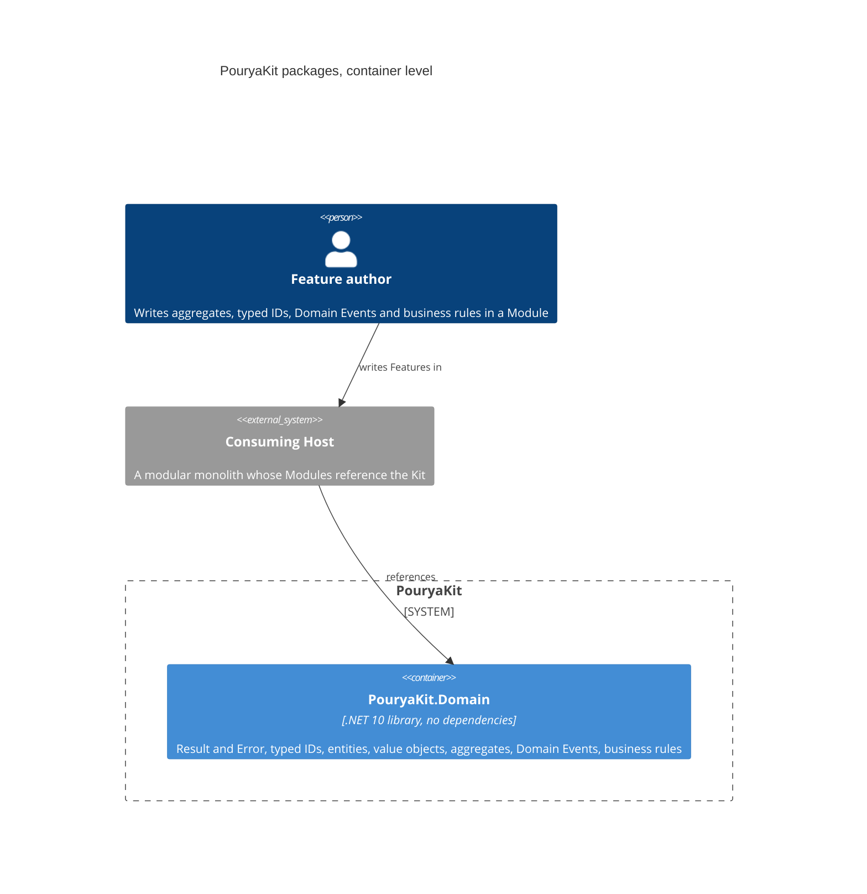

# Architecture

The Kit's packages at C4 container level: each container is one NuGet package a consuming Host references. This view shows only what exists today; each ticket that delivers a package adds it here with its references. The target set of Wave 1 packages and the references allowed between them are in [plan section C](../foundation-review.md#c-package-structure), amended by G.4.

## PouryaKit.Domain

The bottom of the package graph: every other package, and every Module, builds on it. It references no package, not even another Kit package.

| Concern | Types |
|---|---|
| Outcomes | `Result`, `Result<T>`, `Error`, `ErrorKind` |
| Identity | `TypedId<TValue>`, `TypedId`, `TypedIdJsonConverterFactory` |
| Model | `Entity<TId>`, `AggregateRoot<TId>`, `IAggregateRoot`, `ValueObject`, `IBusinessRule` |
| Facts | `DomainEvent` |

Seams later packages build on:

- **Typed-ID registration.** `TypedId.GetValueType(Type)` recognises a concrete typed ID and returns its value type; `TypedId.From<TId, TValue>(value)` creates one. EF Core conventions and Dapper type handlers are registered once from these two; JSON uses `TypedIdJsonConverterFactory`, added once to the serializer options.
- **Version.** `AggregateRoot<TId>.Version` has no mutator in the domain. The Unit of Work advances it once per changed aggregate through the persistence mapping, as the concurrency token.
- **Domain Events.** An aggregate records Domain Events in the order raised. The Unit of Work reads them through `IAggregateRoot.DomainEvents` and clears them through `IAggregateRoot.ClearDomainEvents()`, which is not on the aggregate's own surface.
