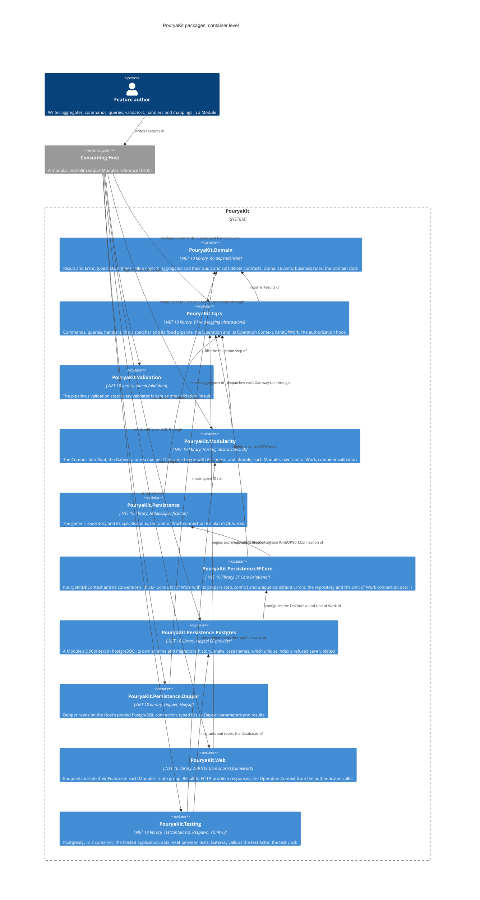

# Architecture

The Kit's packages at C4 container level: each container is one NuGet package a consuming Host references. This view shows only what exists today; each ticket that delivers a package adds it here with its references. The target set of Wave 1 packages and the references allowed between them are in [plan section C](../foundation-review.md#c-package-structure), amended by G.4. The Proving Sample, `samples/ModularMonolith/` with its tests in `tests/ModularMonolith.Tests/`, is a consuming Host of this kind: its Catalog Module uses every package below.

## PouryaKit.Domain

The bottom of the package graph: every other package, and every Module, builds on it. It references no package, not even another Kit package.

| Concern | Types |
|---|---|
| Outcomes | `Result`, `Result<T>`, `Error`, `ErrorKind` |
| Identity | `TypedId<TValue>`, `TypedId`, `TypedIdJsonConverterFactory` |
| Model | `Entity<TId>`, `AggregateRoot<TId>`, `IAggregateRoot`, `ValueObject`, `IBusinessRule` |
| Audit and soft delete | `IAuditable`, `ISoftDeletable` |
| Facts | `DomainEvent` |
| Time | `DomainClock` |

Seams later packages build on:

- **Typed-ID registration.** `TypedId.GetValueType(Type)` recognises a concrete typed ID and returns its value type; `TypedId.From<TId, TValue>(value)` creates one. EF Core conventions and Dapper type handlers are registered once from these two; JSON uses `TypedIdJsonConverterFactory`, added once to the serializer options.
- **Version.** `AggregateRoot<TId>.Version` has no mutator in the domain. It is 0 until saved, 1 after the first commit, and exactly one more for each later Operation that changes the aggregate or anything it holds in a navigation, a removal included; a child moved from one aggregate to another changes both. The Unit of Work advances it through the persistence mapping, where it is the concurrency token; raising a Domain Event does not move it.
- **Audit and soft delete (#11).** `IAuditable` (`CreatedAt`, `CreatedBy`, `LastChangedAt`, `LastChangedBy`) and `ISoftDeletable` (`IsDeleted`, `DeletedAt`, `DeletedBy`) are opt-in contracts with getters only. An aggregate or entity implements their properties with private setters that nothing in the domain calls; the Unit of Work sets them through the persistence mapping.
- **Domain Events.** An aggregate records Domain Events in the order raised. The Unit of Work reads them through `IAggregateRoot.DomainEvents` and clears them through `IAggregateRoot.ClearDomainEvents()`, which is not on the aggregate's own surface.
- **Validation target.** A validation Error may name the input it is about in `Error.Target`; every other Error has none. The Web package groups validation Errors by it.
- **Clock (ADR 0005).** A Domain Event reads its Id and `OccurredOn` once from `DomainClock.Current`: the `TimeProvider` bound to the current asynchronous flow with `DomainClock.Use`, or the system clock when none is bound. The dispatcher binds one for each Operation; the delivery step of Notification and Integration Event Handlers (#15, #16) must bind it around each handler.

## PouryaKit.Cqrs

The execution core every Operation passes through. It references `PouryaKit.Domain`, `Microsoft.Extensions.DependencyInjection.Abstractions` and `Microsoft.Extensions.Logging.Abstractions`, and no other package (ADR 0002: no mediator).

| Concern | Types |
|---|---|
| Operations | `Command`, `Command<TResponse>`, `Query<TResponse>` |
| Handlers | `CommandHandler<TCommand>`, `CommandHandler<TCommand, TResponse>`, `QueryHandler<TQuery, TResponse>` |
| Domain Events | `IDomainEventHandler<TDomainEvent>`, `DomainEventDrain` |
| Dispatch | `IDispatcher`, `CqrsServiceCollectionExtensions.AddPouryaKitCqrs` |
| Pipeline seams | `IAuthorizer<TOperation>`, `IValidationStep<TOperation>`, `IUnitOfWork` |
| Per-Operation state | `Operation` |
| Operation Context | `OperationContext`, `Actor`, `ActorKind`, `OperationContextServiceProviderExtensions.BeginOperation` |

The pipeline is written out in the dispatcher and never registered: logging, the authorization hook, validation, then the handler, inside the Unit of Work for the outermost command. Failure tracking wraps all of it: a command that fails anywhere, by Result or by exception, marks the Operation rollback-only even when the handler that sent it ignores the outcome. A failed query marks nothing. Sending a command from a query handler, or from an authorizer or validator at any nesting depth, throws, as does any command sent while no Unit of Work is active; authorizers and validators may run queries. An exception is logged once, at Error level, by the pipeline where it began.

A Domain Event Handler, `IDomainEventHandler<TDomainEvent>`, reacts to one Domain Event type inside its Module and returns a Result. The contract lives here, beside the other handlers, because the drain that runs it must mark the Operation rollback-only, which only this package can do.

Seams later packages build on:

- **Unit of Work (#8).** `IUnitOfWork.RunAsync` is called once per Operation, for the outermost command only; a nested command runs inside that call and so joins it. An implementation commits only when the command's Result is a success and `Operation.IsRollbackOnly` is false, checked again after every step that can run nested commands, rolls back otherwise, and returns the command's Result after a commit or a failed Result after a rollback. The dispatcher throws `InvalidOperationException` for any other success, and for a success returned while the Operation is rollback-only, because that Unit of Work may already have committed. The dispatcher resolves it only when a command runs, so a query-only service registers none.
- **Domain Event drain (#10, #15).** `DomainEventDrain` is step 2 of the commit sequence of [plan section C](../foundation-review.md#c-package-structure). It is scoped and registered by `AddPouryaKitCqrs`; an `IUnitOfWork` calls `RunAsync` once, after the outermost command succeeded and before it saves, passing the aggregates it tracks, and Feature code never calls it. Each round takes and clears every listed aggregate's Domain Events and runs the handlers of each one's exact type, one at a time, in the ordinal order of their full type names. Rounds repeat until no Domain Event remains, at most `DomainEventDrain.MaxDepth`; more throws `InvalidOperationException`. A failed handler Result marks the Operation rollback-only with its Errors and stops the drain, so the caller checks `IsRollbackOnly` again before it saves. `RunAsync` returns the Domain Events it handled, in the order handled: the EF Core Unit of Work discards them today, and the Outbox write (#15) is meant to store them as Notifications.
- **Operation state.** `Operation` is scoped: one per scope, so one per Operation, and a second outermost command in a scope throws. `IsRollbackOnly` and `RollbackErrors` are read-only outside the package; a failed command or a failed Domain Event Handler sets them, the first failure winning. `Operation.MayChangeState` is false while a query, an authorizer or a validator runs at any depth, and true in a command's handler or a Domain Event Handler; a write seam outside the package checks it before it hands out a connection (see `IUnitOfWorkConnection` below).
- **Operation Context (#13, ADR 0007).** `OperationContext` is an immutable record of the `Actor` (`Actor.Person` or `Actor.System`, with no anonymous or default one), the tenant, the correlation, the causation and its own `OperationId`, a new version 7 Guid for each context. `Continue()` gives the context of an Operation this one causes: the same Actor, tenant and correlation, this `OperationId` as its causation, a new `OperationId`. A continuation is trusted (G.6): the Kit adds no authorization of its own for it, while an `IAuthorizer` registered for the operation it runs still runs, with the original Actor, and can recognise a continuation by its `CausationId`. Whoever opens an Operation's scope begins it once with `IServiceProvider.BeginOperation(context, module)`, which sets the context and `Operation.Module` on the scope's `Operation`; beginning it twice throws. `AddPouryaKitCqrs` registers `OperationContext` as a scoped service read from the scope's `Operation`, so a handler, an authorizer or a validator injects it; resolving it in a scope nobody began throws. The dispatcher itself does not require a context. Nothing in the Kit reads an ambient request.
- **The Operation's Module.** `Operation.Module`, a `Type`, is the Module the scope's opener named, null in an application without Modules. It belongs to the scope rather than to the context, because work an Operation causes may run in another Module. `PouryaKit.Modularity` routes the Unit of Work by it, and delivery steps (#15, #16) will begin their scopes the same way without referencing Modularity.
- **Outcome after a rollback.** When the outermost handler succeeds but the Operation is rollback-only, the dispatcher returns a failure carrying `RollbackErrors`, the Errors of the first failed nested command, so the transport maps the real reason; `PouryaKit.Web` answers them by their kinds. A nested command that threw yields one `Operation.CommandThrew` Error of kind unexpected, with no exception text.
- **Validation step.** `IValidationStep<TOperation>` is resolved per operation type; when nothing registers it, the step does nothing.
- **Clock (ADR 0005).** `AddPouryaKitCqrs` registers `TimeProvider.System` unless a `TimeProvider` is already registered, and the dispatcher binds the container's `TimeProvider` as the `DomainClock` around each Operation. A Host or a test changes the time Operations see by registering its own.
- **Registration.** `AddPouryaKitCqrs(featureAssemblies)` finds internal handlers, authorizers and Domain Event Handlers by reflection, with no `InternalsVisibleTo`, and throws before the container is built when a command or query has no handler or several, when an authorizer is not for one concrete command or query (the dispatcher resolves authorizers by exact type, so one for a base type, a marker interface or an open type would never run), or when a Domain Event Handler handles several Domain Event types or an abstract one (the drain resolves handlers by exact type too). Generic commands, queries, handlers and authorizers are not supported: a generic type definition among them fails registration. A Host must register logging (`ILogger<>`); the Kit never registers a logger of its own.

## PouryaKit.Validation

FluentValidation behind the pipeline's validation step. It references `PouryaKit.Cqrs` and `FluentValidation` only.

| Concern | Types |
|---|---|
| Registration | `ValidationServiceCollectionExtensions.AddPouryaKitValidation` |

`AddPouryaKitValidation(featureAssemblies)` registers the validation step once and every validator in the assemblies given, internal types included. The step runs every validator of the operation and returns one failed Result holding each failure as a validation Error with its property as `Target`; it never throws for invalid input.

## PouryaKit.Modularity

Modules in one Host and one container. It references `PouryaKit.Cqrs`, `Microsoft.Extensions.Hosting.Abstractions` and `Microsoft.Extensions.DependencyInjection`, the last for the service provider factory that validates the container (owner, ticket #13; see [plan section C](../foundation-review.md#allowed-references)).

| Concern | Types |
|---|---|
| Composition Root | `IModuleDefinition`, `ModuleBuilder` |
| Host composition | `ModularityHostApplicationBuilderExtensions.AddPouryaKitModules`, `ModulesBuilder` |
| Gateway | `IGatewayProcessor<TModule>` |

`AddPouryaKitModules` runs each Module's `Configure` once, on a `ModuleBuilder` for that Module, and registers its Gateway as a singleton. Each Gateway call takes a required `OperationContext`, checks that the Module owns the command or query, opens a new scope of the Host container, begins the scope's Operation with that context and the Module (`BeginOperation`), sends the command or query through `IDispatcher`, and disposes the scope when the call returns, so one call is one Operation. A null context throws `ArgumentNullException`; the Gateway never supplies a default Actor.

Seams later packages build on:

- **Each Module's Unit of Work.** `ModuleBuilder` is an `IServiceCollection` over the Host's container. It passes every registration through unchanged except an unkeyed `IUnitOfWork`, which it keys by the Module type, so a persistence package registers its Unit of Work as it would in a single-Module application. `AddPouryaKitModules` then adds the one unkeyed `IUnitOfWork`, which resolves the keyed one of the scope's `Operation.Module`, and throws in a scope whose Operation names no Module or for a Module that registers none.
- **Ownership.** A command or query belongs to the Module whose `ModuleBuilder` registers its handler; the internal `HostModules`, kept in the Host's service collection so every `AddPouryaKitModules` call shares it, records each owner. A Gateway refuses, before it opens a scope, a command or query another Module owns, naming both Modules, and one no Module handles. `ModuleBuilder` reports every registration, replacement and removal, so a second Module that registers or removes the handler of an operation another Module owns fails composition, naming both; the container would otherwise resolve the last handler registered and run it in the wrong Unit of Work. A Module added twice, in one call or across calls, throws naming it.
- **Container validation.** `AddPouryaKitModules` sets a `DefaultServiceProviderFactory` with `ValidateOnBuild` and `ValidateScopes`, so in every environment `Build()` throws when a registration cannot be constructed or a singleton depends on a scoped service. A Host that later calls `ConfigureContainer` with another factory replaces it, and the validation with it.
- **Synchronous questions between Modules (G.5, ADR 0007).** The owning Module publishes an interface in its Contracts project and registers its implementation scoped, so it is resolved in the asking Operation's scope, receives the asking `OperationContext` by injection, and sends a query through its own Module's Gateway with `Continue()`. In the Proving Sample, `CatalogProducts` answers `ICatalogProducts` from `Catalog.Contracts` this way.
- **Without Modularity.** An application of one Module registers Cqrs, Validation and its database package on its own services, opens a scope per Operation and calls `BeginOperation(context)` with no Module; its one Unit of Work is unkeyed and nothing routes.

## PouryaKit.Persistence

The write-side data access contracts, with no storage technology (G.4). It references `PouryaKit.Domain` and `Ardalis.Specification` only.

| Concern | Types |
|---|---|
| Repository | `IRepository<TAggregate, TId>` |
| Plain-SQL writes | `IUnitOfWorkConnection` |

The repository adds, removes and finds by ID, and finds, lists, checks and counts by an Ardalis `ISpecification<TAggregate>`. Nothing on it saves; reads for display go through Dapper (`PouryaKit.Persistence.Dapper`, below). It stays this small: a Module names its specifications beside their Business Area, and a Business Area that needs a query the contract cannot express declares an aggregate-specific repository, an interface deriving from `IRepository<TAggregate, TId>` with only its extra members, implemented over `EfRepository<TAggregate, TId>` (below).

`IUnitOfWorkConnection.Join()` hands out the connection and transaction of the Operation's active Unit of Work, for a Module-internal write with plain SQL, such as Dapper, to a table no aggregate maps (a projection or read model), so that write commits or rolls back with the Operation. The caller passes the transaction to every statement and never disposes, commits or rolls back either. It is a contract here, beside the repository, so a Module's plain-SQL write depends on no storage technology; `PouryaKit.Persistence.EFCore` implements it.

## PouryaKit.Persistence.EFCore

EF Core behind the Unit of Work and the repository. It references `PouryaKit.Cqrs`, `PouryaKit.Persistence`, `Microsoft.EntityFrameworkCore.Relational` and `Ardalis.Specification.EntityFrameworkCore`.

| Concern | Types |
|---|---|
| Model | `PouryaKitDbContext` |
| Repository | `EfRepository<TAggregate, TId>` |
| Registration | `EfCoreServiceCollectionExtensions.AddPouryaKitEfCore<TDbContext>` |
| Refused saves | `UnitOfWorkErrors`, `EfCoreServiceCollectionExtensions.MapUniqueConstraint<TDbContext>`, `IUniqueConstraintReader` |

`PouryaKitDbContext` applies the Kit's conventions once: every typed ID in the DbContext's assembly is stored as its value through `TypedId.GetValueType` and `TypedId.From`, Domain Events are never mapped, every `IEntityTypeConfiguration<T>` in the assembly is applied, and the default schema is the schema of the migrations history table. A typed-ID key is never made database-generated by convention; a mapping marks a numeric one with `ValueGeneratedOnAdd()`. A model-finalizing convention, which also covers entities a derived DbContext maps after the base, makes every aggregate's `Version` its concurrency token and gives every `ISoftDeletable` root entity a named query filter, `PouryaKit.SoftDelete`, that leaves deleted rows out. An `ISoftDeletable` type the filter cannot reach, one derived from a root that is not soft-deletable or an owned type, is refused when the model is built. The DbContext does not cascade a delete when an entity is removed, so a soft-deletable aggregate turned into a mark keeps what it owns; the prepare step resolves the cascades that remain, and an orphan is deleted as soon as it is detected. `AddPouryaKitEfCore<TDbContext>`, called by a database package, adds the DbContext's Unit of Work, not tried, so on a Module's builder it becomes that Module's own, the generic repository, and the `IUnitOfWorkConnection` over the scope's Unit of Work.

Seams later packages build on:

- **The Unit of Work (ADR 0003, ADR 0004).** It begins a transaction and runs the command. When the Result is a success and the Operation is not rollback-only, it runs the Domain Event drain over every aggregate its DbContext's change tracker holds and checks the Operation again. Then it prepares persistence, saves and commits; otherwise it rolls back and returns the command's failure or `RollbackErrors`. An exception, from the command, a Domain Event Handler, the save or the commit, rolls back by disposing the transaction. Nothing retries: a retry needs a new scope. The Outbox write (Messaging) goes between the prepare step and the save, in the order of [plan section C](../foundation-review.md#c-package-structure).
- **The prepare step (#11, ADR 0003 step 3).** Run once, after the drain and before the save, so nothing changes these fields afterwards. It turns the removal of an `ISoftDeletable` entity into its mark; then resolves EF Core's pending cascades itself, so the save changes nothing further: a child of a parent deleted outright is detached when its key is optional, and deleted with the parent when its key is required, even when the child is soft-deletable, because its row cannot outlive the parent's; advances by one, from the value the Operation read, the `Version` of every aggregate with an added, changed or removed entry; and stamps `IAuditable` entities that are added or changed. The time is the Operation's `DomainClock` and the Actor the Id of its `OperationContext`, read once and only when something is stamped, so an Operation that stamps nothing needs no context and one that does in a scope nobody began throws. A child or owned entry reaches its aggregate through each foreign key whose principal navigates to it, by both the holder the key names now and the one it named when loaded, so a moved child changes both aggregates and a detached one the aggregate it left. A holder the Operation did not load throws `InvalidOperationException` and nothing commits, because its version could not advance and a concurrent change would not conflict.
- **A refused save.** A `DbUpdateConcurrencyException` rolls back and fails the Operation with `UnitOfWorkErrors.ConcurrencyConflict` (kind conflict). A `DbUpdateException` that the registered `IUniqueConstraintReader` names a constraint for, and that the DbContext's Module mapped with `MapUniqueConstraint<TDbContext>(constraint, error)`, rolls back and fails with that Error. Mappings are keyed by DbContext type; mapping one constraint twice throws at composition. Every other database error stays an exception. The Unit of Work never retries either.
- **The repository's DbContext.** The repository tracks changes in the DbContext of the scope's Unit of Work, so what a handler adds is what that Unit of Work saves. `AddAsync` and `Remove` throw where `Operation.MayChangeState` is false, in a query, an authorizer or a validator. Specifications are evaluated with `SpecificationEvaluator.Default` only, because Ardalis's own `RepositoryBase` saves.
- **Aggregate-specific repositories (#12).** `EfRepository<TAggregate, TId>` is public and unsealed. A Module's specific repository derives from it, passing the scope's `IUnitOfWork` to its constructor, inherits every generic member, and builds its extra members on them and on the one protected member, `ListAsync<TResult>(ISpecification<TAggregate, TResult>)`, which applies a whole projection specification and returns a loaded list. It gets no `IQueryable`, DbSet or DbContext, because each would let it save or run a bulk update or delete around the Unit of Work's sequence. The Module registers it on its own builder; `ModuleBuilder` re-keys only `IUnitOfWork`, so it shares the scope's DbContext with the generic repository.
- **The Unit of Work connection (#9).** The internal `EfUnitOfWorkConnection` takes the scope's `IUnitOfWork`, so in a Host of Modules the one the scope's `Operation.Module` routes to, and returns its DbContext's connection and current transaction. It throws where `Operation.MayChangeState` is false: a query nested in a command, or a nested command's authorizer or validator, runs inside the active transaction, yet a failed query marks nothing rollback-only and a check runs before its command may proceed, so the transaction alone cannot keep such a write out of the Operation's outcome. It throws too when no transaction is active, and for a Unit of Work that is not the EF Core one. A plain-SQL statement runs when it is called, so it precedes the Unit of Work's save of what the repositories track.

## PouryaKit.Persistence.Postgres

PostgreSQL for a Module's DbContext. It references `PouryaKit.Persistence.EFCore`, `Npgsql.EntityFrameworkCore.PostgreSQL` and `EFCore.NamingConventions`.

| Concern | Types |
|---|---|
| Registration | `PostgresServiceCollectionExtensions.UsePostgres<TDbContext>` |

`UsePostgres<TDbContext>(connectionName, schema)` registers the DbContext on the connection string named in the Host's configuration, puts its migrations history table in the Module's schema (which `PouryaKitDbContext` then makes the default schema), names tables and columns in snake_case, and makes the DbContext the Unit of Work through `AddPouryaKitEfCore`. It also registers, tried, the internal `PostgresUniqueConstraintReader`, the `IUniqueConstraintReader` that names the constraint or unique index of a unique violation (SQLSTATE 23505), so a constraint a Module maps with `MapUniqueConstraint` (`PouryaKit.Persistence.EFCore`) fails the Operation with the Module's Error. It configures no retrying execution strategy, because the Unit of Work owns its transaction. Migrations are created with `dotnet-ef` against the Host; the Host applies none at startup.

## PouryaKit.Persistence.Dapper

Dapper reads in plain SQL (G.4). It references `PouryaKit.Domain`, `Dapper`, `Npgsql`, `Microsoft.Extensions.Configuration.Abstractions` and `Microsoft.Extensions.DependencyInjection.Abstractions`, and no EF Core package.

| Concern | Types |
|---|---|
| Read connections | `IReadConnectionFactory` |
| Registration | `DapperServiceCollectionExtensions.AddPouryaKitDapper` |

`AddPouryaKitDapper(connectionName, typedIdAssemblies)`, called in each Composition Root that reads with Dapper, registers one `IReadConnectionFactory` per Host over the connection string named in the Host's configuration, and a Dapper type handler for every typed ID in the assemblies given. `IReadConnectionFactory.OpenAsync` leases a new open connection from the Host's one Npgsql data source; the caller disposes it, which returns it to the pool. A read connection never joins the Unit of Work. A plain-SQL write that must commit with the Operation uses `IUnitOfWorkConnection` from `PouryaKit.Persistence` instead.

Seams later packages build on:

- **One read connection per Host.** Every Module that reads with Dapper names the same connection; a second name throws at composition. Disposing the Host disposes the pool. `OpenAsync` checks its cancellation token itself before leasing, because Npgsql hands out an idle pooled connection without looking at it.
- **Typed-ID handlers.** Dapper's type handlers are process-wide. A handler depends only on its typed ID's type and holds no state, so a second Module or a second Host in the process registering the same typed ID replaces it with one that behaves identically; Dapper serialises registration. A handler sends a typed ID as its value and converts a column of another type, such as an integer column read into a long ID, to the ID's value type.
- **No model filters.** Dapper runs the SQL it is given; no EF Core query filter, such as the one that leaves soft-deleted rows out, applies to it, so a read states every predicate it needs in its SQL, `is_deleted = false` on a soft-deletable table included.

## PouryaKit.Web

HTTP endpoints over the Modules' Gateways. It references `PouryaKit.Cqrs` and the ASP.NET Core shared framework (`FrameworkReference Microsoft.AspNetCore.App`), no NuGet package, and not `PouryaKit.Modularity`: an endpoint resolves its Module's Gateway from the Host's services itself.

| Concern | Types |
|---|---|
| Endpoints | `IEndpoint`, `WebServiceCollectionExtensions.AddPouryaKitEndpoints`, `WebEndpointRouteBuilderExtensions.MapPouryaKitModuleEndpoints`, `WebEndpointRouteBuilderExtensions.AllowAnonymousAs` |
| Registration | `WebServiceCollectionExtensions.AddPouryaKitWeb`, `PouryaKitWebOptions` |
| Result to HTTP | `ResultHttpExtensions.ToHttpResult` |

`AddPouryaKitWeb` registers problem details, the internal `UnexpectedExceptionHandler`, `RouteHandlerOptions.ThrowOnBadRequest` so a binding failure reaches that handler in every environment, `TypedIdJsonConverterFactory` in the HTTP JSON options, and `PouryaKitWebOptions`. A Composition Root calls `AddPouryaKitEndpoints(routePrefix, assembly)` on its builder, which needs nothing from Modularity because the builder is an `IServiceCollection`; it records every `IEndpoint` of the assembly, internal ones included, with the route prefix, and throws when there is none. `MapPouryaKitModuleEndpoints` maps each Module's endpoints under a route group of its prefix that requires an authenticated caller.

Seams later packages build on:

- **The request's Operation (ADR 0007).** A route-group `Finally` convention wraps each endpoint's built request delegate, so it runs after authorization and before the endpoint binds its parameters; an endpoint filter would run after binding, too late for an endpoint that injects `OperationContext`. It begins the request scope's Operation with no Module: the Gateway the endpoint calls opens the Operation's own scope. The context's Actor is `Actor.Person` from `PouryaKitWebOptions.ActorClaim`, its tenant the `TenantClaim` value or null, and it starts a new chain of work; nothing reads an incoming correlation header. An authenticated caller without the Actor claim throws. An endpoint marked `AllowAnonymous` without `AllowAnonymousAs(actor)` throws when the endpoint is built, which fails the Host's start, so no Operation runs as an unnamed Actor.
- **One failure shape.** `ToHttpResult` writes a failed Result as an RFC 9457 problem response through `ProblemHttpResult`, with every Error in an `errors` member (code, message, validation target) and the status of the most severe kind: unexpected 500, forbidden 403, not found 404, conflict 409, validation 400. `UnexpectedExceptionHandler` writes an exception the same way: 500 without its message, logged at Error, or a `BadHttpRequestException`'s own status, logged at Debug. Both fall back to `application/problem+json` when the caller's `Accept` rules out every problem details writer.
- **The pipeline order.** The Host calls `UseExceptionHandler()` first and `UseRouting()`, `UseAuthentication()` and `UseAuthorization()` explicitly after it; `WebApplication` would otherwise insert those three ahead of the handler. The application configures its own authentication; Web chooses no identity provider (plan section C).

## PouryaKit.Testing

Tests against the hosted application and a real database. It references `PouryaKit.Modularity`, `PouryaKit.Persistence.Postgres`, `Testcontainers.PostgreSql`, `Respawn`, `xunit.v3.extensibility.core` and `Microsoft.Extensions.TimeProvider.Testing`.

| Concern | Types |
|---|---|
| Hosted application | `HostFixture`, `HostTest<TFixture>` |
| Gateway calls | `GatewayTestExtensions`, `GatewayTestExtensions.TestActor` |
| Time | `TestClock` |

`HostFixture` runs PostgreSQL in a container and hosts on it the application the test project builds in `CreateHost`, with the migrations of every DbContext registered with `AddDbContext` applied; `Gateway<TModule>()` sends Operations as the application does. `GatewayTestExtensions` adds `SendAsync` and `QueryAsync` overloads without an `OperationContext` to every Gateway, as C# 14 extension members: each call runs as a new Operation of `TestActor`, the named system Actor `PouryaKit.Testing`. Application code never references this package, so it always names its context (ADR 0007); a test that needs a particular Actor, tenant or correlation passes its own context to the Gateway's own methods. `HostTest<TFixture>` resets the data before each test with Respawn, keeping each schema's migrations history; tests sharing a fixture do not run in parallel. `TestClock` binds a `FakeTimeProvider` as the `DomainClock` for code a test runs directly, inside the test method (ADR 0005). Delivery assertions are #15.
