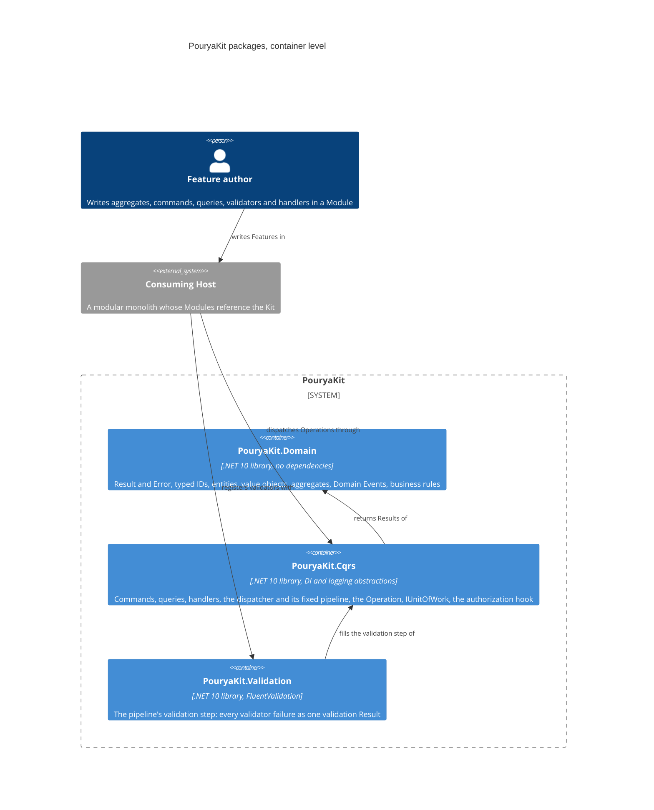

# Architecture

The Kit's packages at C4 container level: each container is one NuGet package a consuming Host references. This view shows only what exists today; each ticket that delivers a package adds it here with its references. The target set of Wave 1 packages and the references allowed between them are in [plan section C](../foundation-review.md#c-package-structure), amended by G.4.

## PouryaKit.Domain

The bottom of the package graph: every other package, and every Module, builds on it. It references no package, not even another Kit package.

| Concern | Types |
|---|---|
| Outcomes | `Result`, `Result<T>`, `Error`, `ErrorKind` |
| Identity | `TypedId<TValue>`, `TypedId`, `TypedIdJsonConverterFactory` |
| Model | `Entity<TId>`, `AggregateRoot<TId>`, `IAggregateRoot`, `ValueObject`, `IBusinessRule` |
| Facts | `DomainEvent` |

Seams later packages build on:

- **Typed-ID registration.** `TypedId.GetValueType(Type)` recognises a concrete typed ID and returns its value type; `TypedId.From<TId, TValue>(value)` creates one. EF Core conventions and Dapper type handlers are registered once from these two; JSON uses `TypedIdJsonConverterFactory`, added once to the serializer options.
- **Version.** `AggregateRoot<TId>.Version` has no mutator in the domain. The Unit of Work advances it once per changed aggregate through the persistence mapping, as the concurrency token.
- **Domain Events.** An aggregate records Domain Events in the order raised. The Unit of Work reads them through `IAggregateRoot.DomainEvents` and clears them through `IAggregateRoot.ClearDomainEvents()`, which is not on the aggregate's own surface.
- **Validation target.** A validation Error may name the input it is about in `Error.Target`; every other Error has none. The Web package groups validation Errors by it.

## PouryaKit.Cqrs

The execution core every Operation passes through. It references `PouryaKit.Domain`, `Microsoft.Extensions.DependencyInjection.Abstractions` and `Microsoft.Extensions.Logging.Abstractions`, and no other package (ADR 0002: no mediator).

| Concern | Types |
|---|---|
| Operations | `Command`, `Command<TResponse>`, `Query<TResponse>` |
| Handlers | `CommandHandler<TCommand>`, `CommandHandler<TCommand, TResponse>`, `QueryHandler<TQuery, TResponse>` |
| Dispatch | `IDispatcher`, `CqrsServiceCollectionExtensions.AddPouryaKitCqrs` |
| Pipeline seams | `IAuthorizer<TOperation>`, `IValidationStep<TOperation>`, `IUnitOfWork` |
| Per-Operation state | `Operation` |

The pipeline is written out in the dispatcher and never registered: logging, the authorization hook, validation, then the handler, inside the Unit of Work for the outermost command. Failure tracking wraps all of it: a command that fails anywhere, by Result or by exception, marks the Operation rollback-only even when the handler that sent it ignores the outcome. A failed query marks nothing. Sending a command from a query handler, or from an authorizer or validator at any nesting depth, throws, as does any command sent while no Unit of Work is active; authorizers and validators may run queries. An exception is logged once, at Error level, by the pipeline where it began.

Seams later packages build on:

- **Unit of Work (#8).** `IUnitOfWork.RunAsync` is called once per Operation, for the outermost command only; a nested command runs inside that call and so joins it. An implementation commits only when the command's Result is a success and `Operation.IsRollbackOnly` is false, rolls back otherwise, and returns the command's Result after a commit or a failed Result after a rollback; the dispatcher throws `InvalidOperationException` for any other success. The dispatcher resolves it only when a command runs, so a query-only service registers none.
- **Operation state (#10, #13).** `Operation` is scoped: one per scope, so one per Operation, and a second outermost command in a scope throws. `IsRollbackOnly` and `RollbackErrors` are read-only outside the package. The Domain Event drain (#10) rechecks them after the drain, because a nested command a Domain Event Handler sends marks the same Operation. The Operation Context (#13) is meant to hang off this type rather than replace it.
- **Outcome after a rollback (#14).** When the outermost handler succeeds but the Operation is rollback-only, the dispatcher returns a failure carrying `RollbackErrors`, the Errors of the first failed nested command, so the transport maps the real reason. A nested command that threw yields one `Operation.CommandThrew` Error of kind unexpected, with no exception text.
- **Validation step.** `IValidationStep<TOperation>` is resolved per operation type; when nothing registers it, the step does nothing.
- **Registration.** `AddPouryaKitCqrs(featureAssemblies)` finds internal handlers and authorizers by reflection, with no `InternalsVisibleTo`, and throws before the container is built when a command or query has no handler or several, or when an authorizer is not for one concrete command or query (the dispatcher resolves authorizers by exact type, so one for a base type, a marker interface or an open type would never run). Generic commands, queries, handlers and authorizers are not supported: a generic type definition among them fails registration. A Host must register logging (`ILogger<>`); the Kit never registers a logger of its own.

## PouryaKit.Validation

FluentValidation behind the pipeline's validation step. It references `PouryaKit.Cqrs` and `FluentValidation` only.

| Concern | Types |
|---|---|
| Registration | `ValidationServiceCollectionExtensions.AddPouryaKitValidation` |

`AddPouryaKitValidation(featureAssemblies)` registers the validation step once and every validator in the assemblies given, internal types included. The step runs every validator of the operation and returns one failed Result holding each failure as a validation Error with its property as `Target`; it never throws for invalid input.
