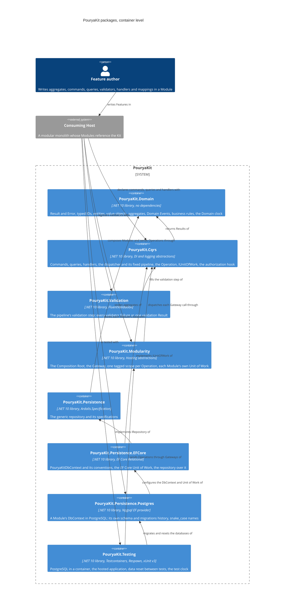

# Architecture

The Kit's packages at C4 container level: each container is one NuGet package a consuming Host references. This view shows only what exists today; each ticket that delivers a package adds it here with its references. The target set of Wave 1 packages and the references allowed between them are in [plan section C](../foundation-review.md#c-package-structure), amended by G.4. The Proving Sample, `samples/ModularMonolith/` with its tests in `tests/ModularMonolith.Tests/`, is a consuming Host of this kind: its Catalog Module uses every package below.

## PouryaKit.Domain

The bottom of the package graph: every other package, and every Module, builds on it. It references no package, not even another Kit package.

| Concern | Types |
|---|---|
| Outcomes | `Result`, `Result<T>`, `Error`, `ErrorKind` |
| Identity | `TypedId<TValue>`, `TypedId`, `TypedIdJsonConverterFactory` |
| Model | `Entity<TId>`, `AggregateRoot<TId>`, `IAggregateRoot`, `ValueObject`, `IBusinessRule` |
| Facts | `DomainEvent` |
| Time | `DomainClock` |

Seams later packages build on:

- **Typed-ID registration.** `TypedId.GetValueType(Type)` recognises a concrete typed ID and returns its value type; `TypedId.From<TId, TValue>(value)` creates one. EF Core conventions and Dapper type handlers are registered once from these two; JSON uses `TypedIdJsonConverterFactory`, added once to the serializer options.
- **Version.** `AggregateRoot<TId>.Version` has no mutator in the domain. The Unit of Work advances it once per changed aggregate through the persistence mapping, as the concurrency token.
- **Domain Events.** An aggregate records Domain Events in the order raised. The Unit of Work reads them through `IAggregateRoot.DomainEvents` and clears them through `IAggregateRoot.ClearDomainEvents()`, which is not on the aggregate's own surface.
- **Validation target.** A validation Error may name the input it is about in `Error.Target`; every other Error has none. The Web package groups validation Errors by it.
- **Clock (ADR 0005).** A Domain Event reads its Id and `OccurredOn` once from `DomainClock.Current`: the `TimeProvider` bound to the current asynchronous flow with `DomainClock.Use`, or the system clock when none is bound. The dispatcher binds one for each Operation; the delivery step of Notification and Integration Event Handlers (#15, #16) must bind it around each handler.

## PouryaKit.Cqrs

The execution core every Operation passes through. It references `PouryaKit.Domain`, `Microsoft.Extensions.DependencyInjection.Abstractions` and `Microsoft.Extensions.Logging.Abstractions`, and no other package (ADR 0002: no mediator).

| Concern | Types |
|---|---|
| Operations | `Command`, `Command<TResponse>`, `Query<TResponse>` |
| Handlers | `CommandHandler<TCommand>`, `CommandHandler<TCommand, TResponse>`, `QueryHandler<TQuery, TResponse>` |
| Domain Events | `IDomainEventHandler<TDomainEvent>`, `DomainEventDrain` |
| Dispatch | `IDispatcher`, `CqrsServiceCollectionExtensions.AddPouryaKitCqrs` |
| Pipeline seams | `IAuthorizer<TOperation>`, `IValidationStep<TOperation>`, `IUnitOfWork` |
| Per-Operation state | `Operation` |

The pipeline is written out in the dispatcher and never registered: logging, the authorization hook, validation, then the handler, inside the Unit of Work for the outermost command. Failure tracking wraps all of it: a command that fails anywhere, by Result or by exception, marks the Operation rollback-only even when the handler that sent it ignores the outcome. A failed query marks nothing. Sending a command from a query handler, or from an authorizer or validator at any nesting depth, throws, as does any command sent while no Unit of Work is active; authorizers and validators may run queries. An exception is logged once, at Error level, by the pipeline where it began.

A Domain Event Handler, `IDomainEventHandler<TDomainEvent>`, reacts to one Domain Event type inside its Module and returns a Result. The contract lives here, beside the other handlers, because the drain that runs it must mark the Operation rollback-only, which only this package can do.

Seams later packages build on:

- **Unit of Work (#8).** `IUnitOfWork.RunAsync` is called once per Operation, for the outermost command only; a nested command runs inside that call and so joins it. An implementation commits only when the command's Result is a success and `Operation.IsRollbackOnly` is false, checked again after every step that can run nested commands, rolls back otherwise, and returns the command's Result after a commit or a failed Result after a rollback. The dispatcher throws `InvalidOperationException` for any other success, and for a success returned while the Operation is rollback-only, because that Unit of Work may already have committed. The dispatcher resolves it only when a command runs, so a query-only service registers none.
- **Domain Event drain (#10, #15).** `DomainEventDrain` is step 2 of the commit sequence of [plan section C](../foundation-review.md#c-package-structure). It is scoped and registered by `AddPouryaKitCqrs`; an `IUnitOfWork` calls `RunAsync` once, after the outermost command succeeded and before it saves, passing the aggregates it tracks, and Feature code never calls it. Each round takes and clears every listed aggregate's Domain Events and runs the handlers of each one's exact type, one at a time, in the ordinal order of their full type names. Rounds repeat until no Domain Event remains, at most `DomainEventDrain.MaxDepth`; more throws `InvalidOperationException`. A failed handler Result marks the Operation rollback-only with its Errors and stops the drain, so the caller checks `IsRollbackOnly` again before it saves. `RunAsync` returns the Domain Events it handled, in the order handled: the EF Core Unit of Work discards them today, and the Outbox write (#15) is meant to store them as Notifications.
- **Operation state (#13).** `Operation` is scoped: one per scope, so one per Operation, and a second outermost command in a scope throws. `IsRollbackOnly` and `RollbackErrors` are read-only outside the package; a failed command or a failed Domain Event Handler sets them, the first failure winning. The Operation Context (#13) is meant to hang off this type rather than replace it.
- **Outcome after a rollback (#14).** When the outermost handler succeeds but the Operation is rollback-only, the dispatcher returns a failure carrying `RollbackErrors`, the Errors of the first failed nested command, so the transport maps the real reason. A nested command that threw yields one `Operation.CommandThrew` Error of kind unexpected, with no exception text.
- **Validation step.** `IValidationStep<TOperation>` is resolved per operation type; when nothing registers it, the step does nothing.
- **Clock (ADR 0005).** `AddPouryaKitCqrs` registers `TimeProvider.System` unless a `TimeProvider` is already registered, and the dispatcher binds the container's `TimeProvider` as the `DomainClock` around each Operation. A Host or a test changes the time Operations see by registering its own.
- **Registration.** `AddPouryaKitCqrs(featureAssemblies)` finds internal handlers, authorizers and Domain Event Handlers by reflection, with no `InternalsVisibleTo`, and throws before the container is built when a command or query has no handler or several, when an authorizer is not for one concrete command or query (the dispatcher resolves authorizers by exact type, so one for a base type, a marker interface or an open type would never run), or when a Domain Event Handler handles several Domain Event types or an abstract one (the drain resolves handlers by exact type too). Generic commands, queries, handlers and authorizers are not supported: a generic type definition among them fails registration. A Host must register logging (`ILogger<>`); the Kit never registers a logger of its own.

## PouryaKit.Validation

FluentValidation behind the pipeline's validation step. It references `PouryaKit.Cqrs` and `FluentValidation` only.

| Concern | Types |
|---|---|
| Registration | `ValidationServiceCollectionExtensions.AddPouryaKitValidation` |

`AddPouryaKitValidation(featureAssemblies)` registers the validation step once and every validator in the assemblies given, internal types included. The step runs every validator of the operation and returns one failed Result holding each failure as a validation Error with its property as `Target`; it never throws for invalid input.

## PouryaKit.Modularity

Modules in one Host and one container. It references `PouryaKit.Cqrs` and `Microsoft.Extensions.Hosting.Abstractions` only.

| Concern | Types |
|---|---|
| Composition Root | `IModuleDefinition`, `ModuleBuilder` |
| Host composition | `ModularityHostApplicationBuilderExtensions.AddPouryaKitModules`, `ModulesBuilder` |
| Gateway | `IGatewayProcessor<TModule>` |

`AddPouryaKitModules` runs each Module's `Configure` once, on a `ModuleBuilder` for that Module, and registers its Gateway as a singleton. Each Gateway call opens a new scope of the Host container, tags it with the Module, sends the command or query through `IDispatcher`, and disposes the scope when the call returns, so one call is one Operation.

Seams later packages build on:

- **Each Module's Unit of Work.** `ModuleBuilder` is an `IServiceCollection` over the Host's container. It passes every registration through unchanged except an unkeyed `IUnitOfWork`, which it keys by the Module type, so a persistence package registers its Unit of Work as it would in a single-Module application. `AddPouryaKitModules` then adds the one unkeyed `IUnitOfWork`, which resolves the keyed one of the Module the scope is tagged with, and throws in a scope no Gateway opened or for a Module that registers none.
- **Module tag (#13).** The internal scoped `ModuleTag` names the Module of the current scope. The Operation Context, startup validation and synchronous questions between Modules (#13) are not built yet.

## PouryaKit.Persistence

The write-side data access contracts, with no storage technology (G.4). It references `PouryaKit.Domain` and `Ardalis.Specification` only.

| Concern | Types |
|---|---|
| Repository | `IRepository<TAggregate, TId>` |

The repository adds, removes and finds by ID, and finds, lists, checks and counts by an Ardalis `ISpecification<TAggregate>`. Nothing on it saves; reads for display are meant to go through Dapper (#9). It stays this small: a Module names its specifications beside their Business Area, and a Business Area that needs a query the contract cannot express declares an aggregate-specific repository, an interface deriving from `IRepository<TAggregate, TId>` with only its extra members, implemented over `EfRepository<TAggregate, TId>` (below).

## PouryaKit.Persistence.EFCore

EF Core behind the Unit of Work and the repository. It references `PouryaKit.Cqrs`, `PouryaKit.Persistence`, `Microsoft.EntityFrameworkCore.Relational` and `Ardalis.Specification.EntityFrameworkCore`.

| Concern | Types |
|---|---|
| Model | `PouryaKitDbContext` |
| Repository | `EfRepository<TAggregate, TId>` |
| Registration | `EfCoreServiceCollectionExtensions.AddPouryaKitEfCore<TDbContext>` |

`PouryaKitDbContext` applies the Kit's conventions once: every typed ID in the DbContext's assembly is stored as its value through `TypedId.GetValueType` and `TypedId.From`, Domain Events are never mapped, every `IEntityTypeConfiguration<T>` in the assembly is applied, and the default schema is the schema of the migrations history table. A typed-ID key is never made database-generated by convention; a mapping marks a numeric one with `ValueGeneratedOnAdd()`. `AddPouryaKitEfCore<TDbContext>`, called by a database package, adds the DbContext's Unit of Work, not tried, so on a Module's builder it becomes that Module's own, and the generic repository.

Seams later packages build on:

- **The Unit of Work (ADR 0003, ADR 0004).** It begins a transaction and runs the command. When the Result is a success and the Operation is not rollback-only, it runs the Domain Event drain over every aggregate its DbContext's change tracker holds, checks the Operation again, and only then saves and commits; otherwise it rolls back and returns the command's failure or `RollbackErrors`. An exception, from the command, a Domain Event Handler, the save or the commit, rolls back by disposing the transaction. Nothing retries: a retry needs a new scope. Audit, soft delete and version bumps (#11) and the Outbox write (Messaging) go between the drain and the save, in the order of [plan section C](../foundation-review.md#c-package-structure).
- **The repository's DbContext.** The repository tracks changes in the DbContext of the scope's Unit of Work, so what a handler adds is what that Unit of Work saves. Specifications are evaluated with `SpecificationEvaluator.Default` only, because Ardalis's own `RepositoryBase` saves.
- **Aggregate-specific repositories (#12).** `EfRepository<TAggregate, TId>` is public and unsealed. A Module's specific repository derives from it, passing the scope's `IUnitOfWork` to its constructor, inherits every generic member, and builds its extra members on them and on the one protected member, `ListAsync<TResult>(ISpecification<TAggregate, TResult>)`, which applies a whole projection specification and returns a loaded list. It gets no `IQueryable`, DbSet or DbContext, because each would let it save or run a bulk update or delete around the Unit of Work's sequence. The Module registers it on its own builder; `ModuleBuilder` re-keys only `IUnitOfWork`, so it shares the scope's DbContext with the generic repository.

## PouryaKit.Persistence.Postgres

PostgreSQL for a Module's DbContext. It references `PouryaKit.Persistence.EFCore`, `Npgsql.EntityFrameworkCore.PostgreSQL` and `EFCore.NamingConventions`.

| Concern | Types |
|---|---|
| Registration | `PostgresServiceCollectionExtensions.UsePostgres<TDbContext>` |

`UsePostgres<TDbContext>(connectionName, schema)` registers the DbContext on the connection string named in the Host's configuration, puts its migrations history table in the Module's schema (which `PouryaKitDbContext` then makes the default schema), names tables and columns in snake_case, and makes the DbContext the Unit of Work through `AddPouryaKitEfCore`. It configures no retrying execution strategy, because the Unit of Work owns its transaction. Migrations are created with `dotnet-ef` against the Host; the Host applies none at startup.

## PouryaKit.Testing

Tests against the hosted application and a real database. It references `PouryaKit.Modularity`, `PouryaKit.Persistence.Postgres`, `Testcontainers.PostgreSql`, `Respawn`, `xunit.v3.extensibility.core` and `Microsoft.Extensions.TimeProvider.Testing`.

| Concern | Types |
|---|---|
| Hosted application | `HostFixture`, `HostTest<TFixture>` |
| Time | `TestClock` |

`HostFixture` runs PostgreSQL in a container and hosts on it the application the test project builds in `CreateHost`, with the migrations of every DbContext registered with `AddDbContext` applied; `Gateway<TModule>()` sends Operations as the application does. `HostTest<TFixture>` resets the data before each test with Respawn, keeping each schema's migrations history; tests sharing a fixture do not run in parallel. `TestClock` binds a `FakeTimeProvider` as the `DomainClock` for code a test runs directly, inside the test method (ADR 0005). Delivery assertions are #15.
