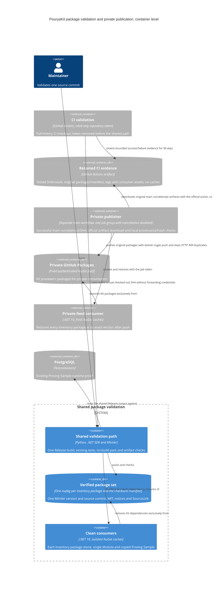
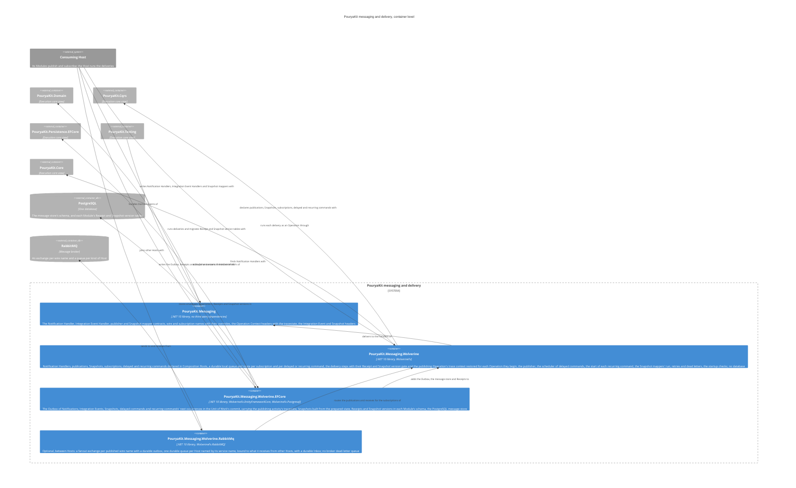
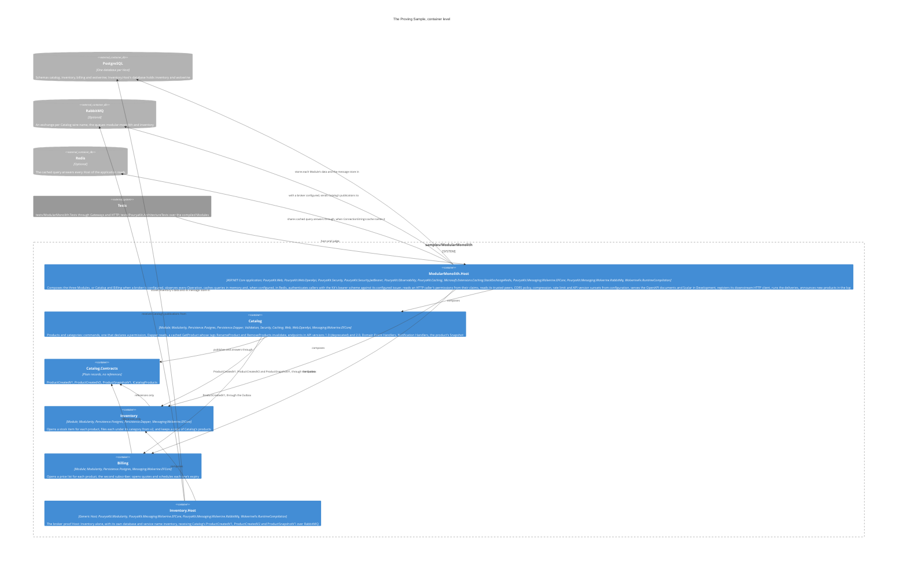

# Architecture

PouryaKit as built: every package in `scripts/packaging/inventory.json`, the thirteen of Wave 1 and Wave 2's `PouryaKit.Core`, `PouryaKit.Security`, `PouryaKit.Security.JwtBearer`, `PouryaKit.Observability`, `PouryaKit.Web.OpenApi`, `PouryaKit.Messaging.Wolverine.RabbitMq` and `PouryaKit.Caching`, each a project that ships as one NuGet package through the [shared package validation path](../packages.md) and that a consuming Host references, and the Proving Sample, `samples/ModularMonolith/` with its tests in `tests/ModularMonolith.Tests/`, whose passing tests are the evidence that the Kit's guarantees hold. The references between the packages are those [plan section C](../foundation-review.md#c-package-structure) allows, as amended there, by G.4 and by I.3's Paging row (`PouryaKit.Persistence.Dapper` references `PouryaKit.Cqrs` for the Page types, ticket #35); `tests/PouryaKit.ArchitectureTests` asserts each package's references and full dependency closure against that table ([Structure tests](#structure-tests)). Which test proves each acceptance scenario of the spec is in [the acceptance map](../acceptance.md). How to use each Capability is the Kit's own skill, [`.agents/skills/pourya-kit/`](../../.agents/skills/pourya-kit/SKILL.md); the decisions behind the design are in [`docs/adr/`](../adr/).

The inventory's packages and their references no longer read as one diagram, so the C4 container level is split into three views: the execution core, messaging and delivery, and the Proving Sample. A package of another view that a view's packages reference appears in it as an external container.

## Views

### Package delivery

The artifact and consumer checks reuse `PackageGraph` and the license policy of the Structure seam. [CI](../ci.md) invokes the same path and distinguishes a PR's tested merge revision from its head SHA. Hosted same-repository success/failure, retained packages and read-only permissions are proven by PR #30; real private fork execution remains explicitly unverified under the owner exception. The [private publisher](../private-packages.md) authorizes successful main push/manual CI, downloads the original artifact, checks local provenance and hashes, then uses standard NuGet push and a fresh restore of every package in the inventory. HTTP 409 skipping does not verify remote byte identity. The active Phase 5 scope is complete; [hosted completion evidence](../private-packages.md#hosted-completion) records the final main CI and publication at `0.1.0-preview.0.13`. Compatibility automation, named cuts and content-verified recovery in #28/#29 are closed as not planned and require a new scoped ticket.

### Execution core

```mermaid
C4Container
    title PouryaKit execution core, container level

    Person(author, "Feature author", "Writes aggregates, commands, queries, validators, handlers, mappings, reads and endpoints in a Module")
    System_Ext(host, "Consuming Host", "A modular monolith whose Modules reference the Kit, such as the Proving Sample")

    System_Boundary(core, "PouryaKit execution core") {
        Container(domain, "PouryaKit.Domain", ".NET 10 library, no dependencies", "Result and Error, typed IDs, entities, value objects, aggregates and their audit and soft-delete contracts, Domain Events, business rules, the Domain clock")
        Container(cqrs, "PouryaKit.Cqrs", ".NET 10 library, DI and logging abstractions", "Commands, queries, their handlers and Domain Event Handlers, the dispatcher and its fixed pipeline with its optional request-idempotency and query-caching slots, the Page contract and its declarations, the Domain Event drain, the Operation, its steps that only read and its Operation Context, IUnitOfWork, IIdempotencyStore and IQueryCache, the authorization hook")
        Container(validation, "PouryaKit.Validation", ".NET 10 library, FluentValidation", "The pipeline's validation step: every validator failure as one validation Result")
        Container(modularity, "PouryaKit.Modularity", ".NET 10 library, Hosting abstractions, DI", "The Composition Root, the Gateway, one scope per Operation begun with its context and Module, each Module's own Unit of Work, composition checks, container validation")
        Container(persistence, "PouryaKit.Persistence", ".NET 10 library, Ardalis.Specification", "The generic repository and its specifications, the Unit of Work connection for plain-SQL writes")
        Container(efcore, "PouryaKit.Persistence.EFCore", ".NET 10 library, EF Core Relational, Ardalis.Specification.EntityFrameworkCore", "PouryaKitDbContext and its conventions, the EF Core Unit of Work and its commit sequence, the prepare step, conflict and unique-constraint Errors, the repository, its Page reads and the Unit of Work connection over it, the idempotency keys in each Module's schema, the Outbox seam")
        Container(postgres, "PouryaKit.Persistence.Postgres", ".NET 10 library, Npgsql EF provider, EFCore.NamingConventions", "A Module's DbContext in PostgreSQL: its own schema and migrations history, snake_case names, which unique index a refused save violated")
        Container(dapper, "PouryaKit.Persistence.Dapper", ".NET 10 library, Dapper, Npgsql, configuration and DI abstractions", "Dapper reads on the Host's pooled PostgreSQL connection, typed IDs as Dapper parameters and results, Page reads of the Feature's own SQL")
        Container(security, "PouryaKit.Security", ".NET 10 library, no third-party dependency", "Permissions declared on commands and queries, an optional permission check on the authorization hook that leaves trusted continuations unchecked, the application's source of an Actor's permissions, optional PBKDF2 password hashing with upgrade detection")
        Container(jwtbearer, "PouryaKit.Security.JwtBearer", ".NET 10 library, Microsoft.AspNetCore.Authentication.JwtBearer", "Standard JWT bearer authentication whose issuer, audience, signature and lifetime checks the Host cannot start without, each verified token's configured claims normalized into the Actor and the tenant")
        Container(observability, "PouryaKit.Observability", ".NET 10 library, System.Diagnostics, no third-party dependency", "One activity and one duration in seconds per command and query, tagged with Module, operation, Actor kind and outcome, current around the whole Operation and its Outbox write; a delivery's Operation continues the publishing Operation's trace; no exporter")
        Container(caching, "PouryaKit.Caching", ".NET 10 library, Microsoft.Extensions.Caching.Hybrid, no distributed cache", "The cacheable query and invalidating command contracts, and the query cache over HybridCache: one GetOrCreateAsync per query, keyed by its type, tenant and Actor, never a failed Result, the declared tags evicted after the outermost commit")
        Container(web, "PouryaKit.Web", ".NET 10 library, ASP.NET Core shared framework, Microsoft.Extensions.Http.Resilience", "Endpoints beside their Feature in each Module's route group, authenticated access by default, Result to HTTP, one problem response for every failure, the Operation Context from the authenticated caller or a continuation from a trusted peer, with the request id of a required Idempotency-Key, the Page request from the query string, outgoing HTTP with the Operation Context and the standard retry, configured CORS policies, response compression and a rate limit per Actor")
        Container(webopenapi, "PouryaKit.Web.OpenApi", ".NET 10 library, optional; Asp.Versioning.Http, Asp.Versioning.OpenApi, Microsoft.AspNetCore.OpenApi, Scalar.AspNetCore", "The API versions a Module declares on its route group, read by URL segment and header, configured sunsets, one OpenAPI document per supported version with each operation's security requirement, the Scalar reference")
        Container(testing, "PouryaKit.Testing", ".NET 10 library, Testcontainers, Respawn, xUnit v3, fake TimeProvider", "PostgreSQL in a container, the hosted application, data reset between tests, Gateway calls as the test Actor, the test clock, waiting for and asserting deliveries and dead letters")
        Container(corehelpers, "PouryaKit.Core", ".NET 10 library, no dependencies", "Three helpers and nothing else: predicate composition with AndAlso and OrElse, implementing-type lookup, the synchronization-context scope")
    }

    Container_Ext(wolverineef, "PouryaKit.Messaging.Wolverine.EFCore", "Messaging and delivery view")
    ContainerDb_Ext(database, "PostgreSQL", "One database", "A schema per Module, with its migrations history")

    Rel(author, host, "writes Features in")
    Rel(host, cqrs, "declares commands, queries and handlers with")
    Rel(host, validation, "registers validators with")
    Rel(host, modularity, "composes Modules and sends Operations through")
    Rel(host, postgres, "stores each Module's data with")
    Rel(host, dapper, "reads with plain SQL through")
    Rel(host, security, "declares permissions and supplies its Actors' permissions to")
    Rel(host, observability, "observes its Operations with")
    Rel(host, caching, "caches queries and declares the tags its commands invalidate with")
    Rel(host, jwtbearer, "authenticates bearer tokens with")
    Rel(host, web, "maps endpoints and answers HTTP with")
    Rel(host, webopenapi, "declares API versions and serves OpenAPI documents and Scalar with")
    Rel(webopenapi, web, "maps versioned Module route groups through the IModuleRouteGroups seam of")
    Rel(host, testing, "is tested with")
    Rel(host, corehelpers, "composes predicates, finds implementing types and replaces the synchronization context with")
    Rel(cqrs, domain, "returns Results of")
    Rel(validation, cqrs, "fills the validation step of")
    Rel(security, cqrs, "checks declared permissions on the authorization hook of")
    Rel(observability, cqrs, "wraps the dispatcher, and reads each Operation's Module, Actor and trace parent, of")
    Rel(caching, cqrs, "fills the query cache slot of")
    Rel(jwtbearer, security, "writes the verified tenant under the claim type of")
    Rel(modularity, cqrs, "dispatches each Gateway call through")
    Rel(persistence, domain, "stores aggregates of")
    Rel(efcore, cqrs, "implements IUnitOfWork, IIdempotencyStore and tracked-state reading guards of")
    Rel(efcore, persistence, "implements IRepository and IUnitOfWorkConnection of")
    Rel(postgres, efcore, "configures the DbContext and Unit of Work of")
    Rel(dapper, cqrs, "reads Page requests into Pages of")
    Rel(cqrs, corehelpers, "finds handlers, authorizers and Domain Event Handlers with")
    Rel(security, corehelpers, "finds the commands and queries that declare a permission with")
    Rel(efcore, corehelpers, "finds typed IDs with")
    Rel(dapper, corehelpers, "finds typed IDs with")
    Rel(web, corehelpers, "finds endpoints with")
    Rel(web, cqrs, "begins each request's Operation with")
    Rel(testing, modularity, "sends Operations through Gateways of")
    Rel(testing, postgres, "migrates and resets the databases of")
    Rel(testing, wolverineef, "waits for and asserts the deliveries of")
    Rel(postgres, database, "writes and migrates")
    Rel(dapper, database, "reads")
```

### Messaging and delivery

### The Proving Sample

Inventory and Billing reference Catalog's Contracts and never Catalog. Each subscribes to `ProductCreatedV1` under its own subscription and applies it on its own: Inventory opens a stock item for each product, and Billing a price list. Catalog publishes `ProductCreatedV2`, which adds the product's category, beside v1 from the same Notification Handler, as during a move from one version to the next; Inventory's `inventory.product-categories` subscribes to v2 alone and files each product under its category in a table no aggregate maps, and no v1 subscription receives v2. Catalog also publishes `ProductSnapshotV1`, the Snapshot of each product it changes and the Tombstone of each it removes, and Inventory keeps from it its own copy of Catalog's products, a table no aggregate maps, written with plain SQL in Inventory's Unit of Work. Billing's `OpenQuote` schedules `ExpireQuote` for the quote's expiry with `IDelayedCommands`, a delayed command the message store holds until it is due and Billing then runs as a continuation of the Operation that opened the quote. Inventory declares `ReconcileStock` as a recurring command under the system Actor `inventory.stock-reconciler`, at the cadence the Host's configuration sets (`Inventory:ReconcileStock:Every`, an hour): each occurrence records a reconciliation row, with its time and its Actor, in a table no aggregate maps, and stores the next occurrence in the same commit.

The service composition (ticket #51): with the connection string `broker` configured, `ModularMonolith.Host` hosts Catalog and Billing, joins RabbitMQ under the service name `modular-monolith`, and leaves Inventory to `Inventory.Host`, a generic Host of the unchanged Inventory Module with its own database and the service name `inventory`, which declares Catalog's three wire names with `Receive` and `ReceiveSnapshot` and runs with `dotnet run`. It is a proof Host, not a template. Billing still receives `ProductCreatedV1` inside its Host, from the publication itself; `ProductCreatedV2` and the Snapshot then have no subscription in the publishing Host and are written to the Outbox for the broker alone. `RabbitMqDeliveryTests` runs both Hosts against RabbitMQ and PostgreSQL in Testcontainers, one of them with `Inventory.Host` as an OS process.

## The commit sequence

The EF Core Unit of Work (`EfUnitOfWork`, `PouryaKit.Persistence.EFCore`) runs every command Operation in this order, the order ADR 0003 and ADR 0004 fixed:

1. **Begin** a transaction on the Module's DbContext.
2. **Run the command**: the outermost handler, with every nested command joining this Unit of Work. For an `[Idempotent]` outermost command with a request id, the dispatcher's idempotency slot first reserves its key in this transaction and, after the handler succeeds, records the success there; a key a committed Operation holds replays its success instead, and the steps below then have nothing to do ([PouryaKit.Cqrs](#pouryakitcqrs)).
3. **Check** that the command's Result is a success and the Operation is not rollback-only; otherwise roll back.
4. **Drain the Domain Events** of every aggregate the DbContext tracks (`DomainEventDrain`, `PouryaKit.Cqrs`), round after round, one Domain Event Handler at a time, until none remains or the depth guard throws; a failed handler stops it.
5. **Check again**: a Domain Event Handler may have failed, or ignored a nested command that failed.
6. **Prepare persistence** (`PersistencePreparation`): turn the removal of a soft-deletable entity into its mark, resolve the cascades of what is deleted, advance each changed aggregate's `Version` by one, stamp audit fields; it returns the changed aggregates.
7. **Build the Snapshots** of the changed aggregates a Snapshot is declared for, or their Tombstones, from that prepared state, each mapper in a step that only reads, and check that nothing the Unit of Work saves changed (`SnapshotStep`, `PouryaKit.Messaging.Wolverine.EFCore`).
8. **Write the Outbox**: each Domain Event a Notification Handler subscribes to, as a Notification, each Integration Event a Notification Handler's delivery published, and each Snapshot, once per subscription, and each command the Operation scheduled, due at its time, in this transaction (`WolverineOutbox`).
9. **Check once more**: a Snapshot mapper may have caught the refusal of a command it sent, which still marked the Operation rollback-only.
10. **Save** once. A concurrency conflict, or a violation of a unique constraint the Module mapped, rolls back and fails the Operation with an Error.
11. **Commit**.
12. **Flush**: send what step 8 wrote. A failed send is logged; the message store recovers the committed envelopes.

Once the Unit of Work has returned the command's success, the dispatcher evicts the cache tags the Operation's commands declared, through its query-caching slot ([PouryaKit.Cqrs](#pouryakitcqrs)); a rollback evicts nothing.

Any other outcome rolls back and returns the command's failure or the Operation's `RollbackErrors`, leaving nothing in the Outbox; an exception at any step rolls back by disposing the transaction. Nothing retries: a retry needs a new scope. Steps 7, 8 and 12 run through the `IUnitOfWorkOutbox` seam and are skipped when no messaging package registers one. Plan section C states the same sequence in five steps: its step 1 is steps 2 and 3 here, its step 2 steps 4 and 5, its step 3 step 6, its step 4 step 7, and its step 5 steps 8 to 12.

## PouryaKit.Domain

The bottom of the package graph: every other package, and every Module, builds on it. It references no package, not even another Kit package.

| Concern | Types |
|---|---|
| Outcomes | `Result`, `Result<T>`, `Error`, `ErrorKind` |
| Identity | `TypedId<TValue>`, `TypedId`, `TypedIdJsonConverterFactory` |
| JSON | `JsonSerializerOptionsExtensions` (`UsePouryaKitJson`) |
| Model | `Entity<TId>`, `AggregateRoot<TId>`, `IAggregateRoot`, `ValueObject`, `IBusinessRule` |
| Audit and soft delete | `IAuditable`, `ISoftDeletable` |
| Facts | `DomainEvent` |
| Time | `DomainClock` |

Seams later packages build on:

- **Typed-ID registration.** `TypedId.GetValueType(Type)` recognises a concrete typed ID and returns its value type; `TypedId.From<TId, TValue>(value)` creates one. EF Core conventions and Dapper type handlers are registered once from these two; JSON uses `TypedIdJsonConverterFactory`, which `UsePouryaKitJson` adds.
- **One JSON representation.** `options.UsePouryaKitJson()` sets the Kit's System.Text.Json representation on a `JsonSerializerOptions` and returns it: camelCase property names, read ignoring case, the relaxed encoder that escapes only what JSON requires, and `TypedIdJsonConverterFactory`, so a typed ID over Guid, long, int or string is written as its bare value. It is the only place these are set: Web applies it to ASP.NET Core's HTTP options and Messaging.Wolverine to Wolverine's message options, each an instance its framework creates, so a typed ID has the same JSON in a response and in a stored or delivered envelope. Each framework keeps its own read leniency: ASP.NET Core reads numbers from strings, Wolverine accepts trailing commas and comments. Applying it twice changes nothing; code that needs options of its own creates them and applies it (`new JsonSerializerOptions().UsePouryaKitJson()`). `SharedJsonTests` in the structure seam keeps every other setup out.
- **Version.** `AggregateRoot<TId>.Version` has no mutator in the domain. It is 0 until saved, 1 after the first commit, and exactly one more for each later Operation that changes the aggregate or anything it holds in a navigation, a removal included; a child moved from one aggregate to another changes both. The Unit of Work advances it through the persistence mapping, where it is the concurrency token; raising a Domain Event does not move it.
- **Audit and soft delete.** `IAuditable` (`CreatedAt`, `CreatedBy`, `LastChangedAt`, `LastChangedBy`) and `ISoftDeletable` (`IsDeleted`, `DeletedAt`, `DeletedBy`) are opt-in contracts with getters only. An aggregate or entity implements their properties with private setters that nothing in the domain calls; the Unit of Work sets them through the persistence mapping.
- **Domain Events.** An aggregate records Domain Events in the order raised. The Unit of Work reads them through `IAggregateRoot.DomainEvents` and clears them through `IAggregateRoot.ClearDomainEvents()`, which is not on the aggregate's own surface.
- **Validation target.** A validation Error may name the input it is about in `Error.Target`; every other Error has none. The Web package groups validation Errors by it.
- **Clock (ADR 0005).** A Domain Event reads its Id and `OccurredOn` once from `DomainClock.Current`: the `TimeProvider` bound to the current asynchronous flow with `DomainClock.Use`, or the system clock when none is bound. The dispatcher binds one for each Operation. The delivery step of `PouryaKit.Messaging.Wolverine` runs each Notification Handler and Integration Event Handler as an Operation through the dispatcher, so it is bound there too.

## PouryaKit.Cqrs

The execution core every Operation passes through. It references `PouryaKit.Domain`, `PouryaKit.Core`, whose `ImplementingTypes` finds its handlers, authorizers and Domain Event Handlers (#55), `Microsoft.Extensions.DependencyInjection.Abstractions` and `Microsoft.Extensions.Logging.Abstractions`, and no other package (ADR 0002: no mediator).

| Concern | Types |
|---|---|
| Operations | `Command`, `Command<TResponse>`, `Query<TResponse>` |
| Handlers | `CommandHandler<TCommand>`, `CommandHandler<TCommand, TResponse>`, `QueryHandler<TQuery, TResponse>` |
| Domain Events | `IDomainEventHandler<TDomainEvent>`, `DomainEventDrain` |
| Dispatch | `IDispatcher`, `CqrsServiceCollectionExtensions.AddPouryaKitCqrs` |
| Pipeline seams | `IAuthorizer<TOperation>`, `IValidationStep<TOperation>`, `IUnitOfWork`, `IReadingStateGuard` |
| Declared authorizers | `IRequiresAuthorizer`, implemented by the Kit's own attributes only |
| Per-Operation state | `Operation`, `Operation.OnlyReading`, `Operation.Context`, `Operation.TraceParent` |
| Operation Context | `OperationContext`, `Actor`, `ActorKind`, `OperationContextServiceProviderExtensions.BeginOperation` |
| Request idempotency | `IdempotentAttribute`, `OperationContext.RequestId`, `IIdempotencyStore`, `IdempotencyKey`, `RecordedSuccess` |
| Query caching | `IQueryCache`, `OperationContext.NoTenant` |
| Paging | `PageRequest`, `PageFilter`, `SortDirection`, `FilterOperator`, `FilterOperatorNames`, `Page<T>`, `PageDeclaration`, `FilterField` |

The pipeline is written out in the dispatcher and never registered: logging, the authorization hook, validation, then the handler, inside the Unit of Work for the outermost command. Failure tracking wraps all of it: a command that fails anywhere, by Result or by exception, marks the Operation rollback-only even when the handler that sent it ignores the outcome. A failed query Result alone marks nothing; a tracked-state change detected at a reading boundary marks the Operation rollback-only and throws, even when its caller catches the exception. Sending a command from a query handler, from an authorizer or validator at any nesting depth, or from a step that only reads (`Operation.OnlyReading`, below), throws, as does any command sent while no Unit of Work is active; authorizers, validators and steps that only read may run queries. An exception is logged once, at Error level, by the pipeline where it began.

A Domain Event Handler, `IDomainEventHandler<TDomainEvent>`, reacts to one Domain Event type inside its Module and returns a Result. The contract lives here, beside the other handlers, because the drain that runs it must mark the Operation rollback-only, which only this package can do.

Seams later packages build on:

- **Request idempotency (ticket #42, ADR 0002).** The first of the pipeline's two optional slots, written out in `Dispatcher.Steps` and filled by no registration. When the outermost command opts in with `[Idempotent]` and the Operation's `OperationContext.RequestId` is set, the dispatcher builds its `IdempotencyKey` (tenant, Actor, the command's full type name, request id) and, inside the `IUnitOfWork.RunAsync` call, before the handler, asks the scope's `IIdempotencyStore` to reserve it: a `RecordedSuccess` back means a committed Operation holds the key, and its value, read from JSON in the Kit's representation, replaces the handler's Result; otherwise the handler runs and its success value is recorded with `RecordAsync` in the same transaction, a `Result` success recording nothing beyond the key. A failure records nothing and the Unit of Work rolls the key back. A nested command never reaches the slot, and a request id on an outermost command that does not opt in, or with no store registered, throws before the Unit of Work starts. The request id is Operation Context data because a Gateway opens the Operation's own scope and receives only the context; `Continue()` leaves it out and no message header carries it. A store writes in the Unit of Work's own transaction and never saves or commits.
- **Query caching (ticket #43, ADR 0002).** The second optional slot, written out in `Dispatcher.Steps` after the checks and filled only by `PouryaKit.Caching`, which registers the singleton `IQueryCache`; Cqrs never references Caching, and the dispatcher takes the cache as an optional constructor argument, so a Host without it pays one null check. A query outside an active write Unit of Work (`Operation.StartUnitOfWork` to `EndUnitOfWork`) goes to `IQueryCache.QueryAsync` with its Operation's context and a delegate that runs its handler; inside one it runs as before, neither read nor stored, since it may see uncommitted state. Each command that passes its checks, outermost or nested, is asked for its tags (`TagsInvalidatedBy`); the Operation collects them, de-duplicated, and the dispatcher calls `EvictAsync` only after `IUnitOfWork.RunAsync` returned the command's own success, after the rollback-only check, never after a rollback. `OperationContext.NoTenant`, the empty string, is the tenant a key names for an Operation without one; `PouryaKit.Persistence.EFCore`'s `IdempotencyTable.NoTenant` holds the same value.
- **Unit of Work.** `IUnitOfWork.RunAsync` is called once per Operation, for the outermost command only; a nested command runs inside that call and so joins it. An implementation commits only when the command's Result is a success and `Operation.IsRollbackOnly` is false, checked again after every step that can run nested commands, rolls back otherwise, and returns the command's Result after a commit or a failed Result after a rollback. The dispatcher throws `InvalidOperationException` for any other success, and for a success returned while the Operation is rollback-only, because that Unit of Work may already have committed. Only commands call `RunAsync`. Reading boundaries resolve an optional `IReadingStateGuard` through the same scoped Unit of Work, without starting a transaction; a query-only service still registers no Unit of Work.
- **Domain Event drain.** `DomainEventDrain` is step 4 of [the commit sequence](#the-commit-sequence). It is scoped and registered by `AddPouryaKitCqrs`; an `IUnitOfWork` calls `RunAsync` once, after the outermost command succeeded and before it saves, passing the aggregates it tracks, and Feature code never calls it. Each round takes and clears every listed aggregate's Domain Events and runs the handlers of each one's exact type, one at a time, in the ordinal order of their full type names. Rounds repeat until no Domain Event remains, at most `DomainEventDrain.MaxDepth`; more throws `InvalidOperationException`. A failed handler Result marks the Operation rollback-only with its Errors and stops the drain, so the caller checks `IsRollbackOnly` again before it saves. `RunAsync` returns every Domain Event it took, whether or not a Domain Event Handler handled it, in the order handled: the EF Core Unit of Work passes them to the Outbox write (step 8), which stores those a Notification Handler subscribes to as Notifications.
- **Declared authorizers.** `IRequiresAuthorizer` is implemented by a Kit attribute that, on a command or query, requires one of the Kit's authorizers to be registered for it, as `PouryaKit.Security`'s `RequiresPermissionAttribute` does: `AuthorizerOf(operation)` names the `IAuthorizer<T>` implementation and `Registration` the call that adds it. Only the Kit's own attributes implement it; applications do not. It is a public Cqrs type because nothing else reaches every Host: the failure it catches is exactly a Module whose Composition Root never called `AddPouryaKitPermissions`, so Security's registration cannot carry the check; the Host's permission source is a plain `IActorPermissions` registration that runs no Kit code; `PouryaKit.Modularity` is the only Kit code that runs after every Composition Root, and it may reference only Cqrs, not Security; and the Kit's one `InternalsVisibleTo` between packages opens Cqrs to delivery and Web for restoring a trusted continuation only (ticket #57). It adds no pipeline step and the dispatcher never reads it (ADR 0002). `AddPouryaKitModules` checks it when the Host is built (see Container validation under `PouryaKit.Modularity`).
- **Operation state.** `Operation` is scoped: one per scope, so one per Operation, and a second outermost command in a scope throws. `IsRollbackOnly` and `RollbackErrors` are read-only outside the package; a failed command, a failed Domain Event Handler or a refused tracked-state change sets them, the first failure winning. `Operation.MayChangeState` is false in code that only reads: while a query, an authorizer or a validator runs at any depth, and while a step opened with `Operation.OnlyReading` runs; it is true in a command's handler or a Domain Event Handler. A write seam outside the package checks it before it writes or hands out a connection (see the repository and `IUnitOfWorkConnection` below, and the publisher of `PouryaKit.Messaging.Wolverine`).
- **Tracked-state reading guard.** `IReadingStateGuard` is an optional persistence seam. The scoped `Operation` opens it around each query, its authorization and validation checks, and explicit reading step. The EF Unit of Work snapshots current tracked state, preserving legitimate changes made before the read and capturing entities first loaded during it. Boundary disposal compares that state even after a failed Result or exception. Capture and comparison force change detection when EF automatic detection is disabled, so retained navigation changes cannot escape the comparison. A violation marks the Operation rollback-only before throwing, so catching it cannot permit a commit. Modularity resolves the guard through the same owner route as the Unit of Work, and a Module without persistence has no guard. Snapshot mappers use `OnlyReading(step, compareTrackedState: false)` because `SnapshotStep` owns one comparison of the whole batch. The per-mapper step retains every write-entry guard; a query invoked by a mapper still gets its query comparison.
- **Steps that only read.** `Operation.OnlyReading(step)` opens a step that only reads, named `step`, until the returned `IDisposable` is disposed. A Kit package opens it around application code it runs after the Operation's last change; `SnapshotMappers.Map` opens it around each Snapshot mapper call as `a Snapshot mapper`. While it is open `MayChangeState` is false, so every write the Kit guards is refused, and a command is refused with a message naming the step (`A command was sent from a Snapshot mapper, a step that only reads.`); a query runs as usual. A refused command still marks the Operation rollback-only, as any command that throws does. Steps nest; disposing one closes that step only, whatever else is open, and disposing it again does nothing. The step opens before the mapper is resolved, so a mapper's constructor only reads too. Feature code never opens one.
- **Operation Context (ADR 0007).** `OperationContext` is an immutable record of the `Actor` (`Actor.Person` or `Actor.System`, with no anonymous or default one), the tenant (null or never blank: the constructor refuses a blank one, ticket #42), the correlation, the causation and its own `OperationId`, a new version 7 Guid for each context. `Continue()` gives the context of an Operation this one causes: the same Actor, tenant and correlation, this `OperationId` as its causation, a new `OperationId`. The causation is informational. Only the Kit marks a context as a trusted continuation, with `IsTrustedContinuation` (G.6, ticket #57), and it does so in two cases. The first is `Continue()` called on the exact context of an Operation the dispatcher is running past its authorization checks, from inside that Operation. The dispatcher holds that context ambiently (internal `AuthorizedOperation`), only to check this claim: it clears it while the checks of a nested command or query run, and ends it when the Operation returns. The second is the delivery step of `PouryaKit.Messaging.Wolverine`, which restores the context from the Outbox headers the Kit wrote, through `OperationContext.RestoreTrusted`. That member is internal and is opened by Cqrs's one `InternalsVisibleTo`, to `PouryaKit.Messaging.Wolverine` and `PouryaKit.Web` only (`TrustedRestoreTests`). The public constructor never sets the mark, whatever causation it is given. `Continue()` on a context that never ran, or whose Operation has ended, is not trusted either. The Kit adds no authorization of its own for a trusted continuation, while an `IAuthorizer` registered for the operation it runs still runs, with the original Actor, and recognises it by `IsTrustedContinuation`, as `PouryaKit.Security`'s permission check does. Whoever opens an Operation's scope begins it once with `IServiceProvider.BeginOperation(context, module)`, which sets the context and `Operation.Module` on the scope's `Operation`; beginning it twice throws. `AddPouryaKitCqrs` registers `OperationContext` as a scoped service read from the scope's `Operation`, so a handler, an authorizer or a validator injects it; resolving it in a scope nobody began throws. The dispatcher itself does not require a context. Nothing in the Kit reads an ambient request.
- **The Operation's Module.** `Operation.Module`, a `Type`, is the Module the scope's opener named, null in an application without Modules. It belongs to the scope rather than to the context, because work an Operation causes may run in another Module. `PouryaKit.Modularity` routes the Unit of Work by it, and the delivery step of `PouryaKit.Messaging.Wolverine` begins its scopes the same way, with the subscribing Module, without referencing Modularity.
- **The Operation's trace parent (ADR 0009, ticket #47).** `Operation.TraceParent`, an `ActivityContext`, is the trace context of the work that caused the Operation, as a message delivery restored it with `BeginOperation(context, module, traceParent)`: the publishing activity's W3C id, which Wolverine stores as the envelope's `parent-id`, with the tracestate the Kit's Outbox wrote beside it. It is default for an Operation begun at a Gateway or the HTTP boundary, where the caller's activity is current. Cqrs only records it; `PouryaKit.Observability` starts the Operation's activity with it. `Operation.Context` is the context the scope was begun with, null before, so Observability tags the Actor kind without resolving `OperationContext`, which throws in a scope not yet begun.
- **Outcome after a rollback.** When the outermost handler succeeds but the Operation is rollback-only, the dispatcher returns a failure carrying `RollbackErrors`, the Errors of the first failed nested command, so the transport maps the real reason; `PouryaKit.Web` answers them by their kinds. A nested command that threw yields one `Operation.CommandThrew` Error of kind unexpected, with no exception text.
- **Validation step.** `IValidationStep<TOperation>` is resolved per operation type; when nothing registers it, the step does nothing.
- **Paging (ticket #35).** `PageRequest` is a query's 1-based `Number`, its `Size` (default 20), an optional `Sort` key, a `SortDirection` and `PageFilter`s, each a field, a `FilterOperator` and a value of the field's type or text that parses to it. `Page<T>` is the answer: `Items`, `Number`, `Size`, the `Total` of the filtered selection, and the derived `TotalPages` (computed without overflow up to `long.MaxValue`), `HasNext` and `HasPrevious`; a Page beyond the last has no items and the true total. A Feature declares what its read allows in a `PageDeclaration`: sort keys (the first is the default), `FilterField.Of<TValue>(name, operators)` for each filter field, with value types string, Guid, int, long, decimal, bool and DateTimeOffset (a time without an offset is UTC, and every time is read as UTC, the only offset Npgsql sends to `timestamptz`, so both helpers bind the same instant), and a maximum size (default 100, never below the default size of 20, which would refuse every request that states no size). Names are a letter followed by letters and digits, and the declaration refuses an operator its type cannot use: `contains` and `startswith` take text only, the ordering operators no text, Guid or bool. Each operator has one short name, `FilterOperator.Name` (`eq`, `ne`, `contains`, `startswith`, `gt`, `gte`, `lt`, `lte`), used by the HTTP query string and the Dapper parameter names. `PageDeclaration.Validate` returns one validation Error per thing outside the declaration (`Page.NumberOutOfRange`, `Page.SizeOutOfRange`, `Page.SortUnknown`, `Page.DirectionUnknown`, `Page.FilterUnknown`, `Page.FilterOperatorUnsupported`, `Page.FilterValueInvalid`, `Page.FilterRepeated`), targeting `Number`, `Size`, `Sort`, `Direction` or `Filters[i]`, without repeating what the caller sent; the query's own validator calls it, so it runs in the one validation step (G.8). `ValueOf` reads a filter's typed value the way validation did, for the persistence helpers. The declaration holds names only: the Dapper and EF Core helpers map each name to the Feature's column or expression, and they refuse a request that fails the declaration with an exception before any SQL runs. Allow-listed filters were added to the plan's paging design (I.2.1) at the owner's request in spec #33.
- **Clock (ADR 0005).** `AddPouryaKitCqrs` registers `TimeProvider.System` unless a `TimeProvider` is already registered, and the dispatcher binds the container's `TimeProvider` as the `DomainClock` around each Operation. A Host or a test changes the time Operations see by registering its own.
- **Registration.** `AddPouryaKitCqrs(featureAssemblies)` finds internal handlers, authorizers and Domain Event Handlers by reflection, with no `InternalsVisibleTo`, and throws before the container is built when a command or query has no handler or several, when an authorizer is not for one concrete command or query (the dispatcher resolves authorizers by exact type, so one for a base type, a marker interface or an open type would never run), or when a Domain Event Handler handles several Domain Event types or an abstract one (the drain resolves handlers by exact type too). Generic commands, queries, handlers and authorizers are not supported: a generic type definition among them fails registration. A Host must register logging (`ILogger<>`); the Kit never registers a logger of its own.

## PouryaKit.Validation

FluentValidation behind the pipeline's validation step. It references `PouryaKit.Cqrs` and `FluentValidation` only.

| Concern | Types |
|---|---|
| Registration | `ValidationServiceCollectionExtensions.AddPouryaKitValidation` |

`AddPouryaKitValidation(featureAssemblies)` registers the validation step once and every validator in the assemblies given, internal types included. The step runs every validator of the operation and returns one failed Result holding each failure as a validation Error with its property as `Target`; it never throws for invalid input.

## PouryaKit.Security

Permissions a command or query declares, checked on the pipeline's authorization hook (G.6, ticket #38), and optional PBKDF2 password hashing (ticket #40). It references `PouryaKit.Cqrs` and `PouryaKit.Core`, for its type lookup (#55), and nothing else: no ASP.NET Core, no identity store and no role system, so a Host without HTTP uses it too. The authenticated HTTP default lives in `PouryaKit.Web`, which owns the HTTP boundary.

| Concern | Types |
|---|---|
| Declaration | `RequiresPermissionAttribute` |
| The Actor's permissions | `IActorPermissions`, which the application implements and registers |
| Registration | `SecurityServiceCollectionExtensions.AddPouryaKitPermissions` |
| Denial | `PermissionErrors.Denied`, of kind forbidden |
| Password hashing | `IPasswordHasher`, `PasswordVerification`, `PasswordHashingOptions`, `PasswordHashAlgorithm`; registered by `PasswordHashingServiceCollectionExtensions.AddPouryaKitPasswordHashing` |

`AddPouryaKitPermissions(featureAssemblies)` registers the internal `PermissionAuthorizer<T>` as an `IAuthorizer<T>` for each command or query in the assemblies that declares `[RequiresPermission(name)]`, and for nothing else, so a Module opts its Operations in where its Composition Root calls it; it throws when the attribute is on a type that is not one concrete command or query. Its check runs in the authorization step like any authorizer, before validation and the Unit of Work. It asks the application's `IActorPermissions` whether the context's Actor holds the permission and fails the Operation with `PermissionErrors.Denied` when it does not, which `PouryaKit.Web` answers with 403; a command denied this way commits nothing. A trusted continuation, an Operation whose `OperationContext.IsTrustedContinuation` is true (ADR 0007, ticket #57), is not checked: it runs on the authority of the authorized Operation that caused it, whatever that Actor may do by the time it runs. Only the permission check stands aside; every other `IAuthorizer<T>` registered for a continued operation still runs, with the original Actor, as the dispatcher promises. A Host composed with `AddPouryaKitModules` fails when it is built if a command or query whose handler it registers declares a permission and no Composition Root registered its check (ticket #56): `Build()` throws `InvalidOperationException` with one line per such operation, naming it, its assembly and the Module whose Composition Root must call `AddPouryaKitPermissions`. The check is registered by any Composition Root, so a permission declared in one Module and registered from another passes, and a Host with no declaring type is unaffected. A Host that never references `PouryaKit.Security` cannot declare a permission, since the attribute lives here. The container validation that `AddPouryaKitModules` turns on then fails the Host's build when permissions are checked and no `IActorPermissions` is registered.

`AddPouryaKitPasswordHashing(configure)` registers one `IPasswordHasher` singleton, the internal `Pbkdf2PasswordHasher`, which uses `Rfc2898DeriveBytes.Pbkdf2`, `RandomNumberGenerator` and `CryptographicOperations.FixedTimeEquals` from `System.Security.Cryptography` and nothing else; it needs no permission registration, and the Kit stores no password, user or account. It checks the options when it runs and throws, naming every problem, when one is outside its bounds: PBKDF2-HMAC-SHA256 with at least 600,000 iterations (the default) or PBKDF2-HMAC-SHA512 with at least 220,000, at most 10,000,000; a salt of 16 (the default) to 64 bytes; a key of 32 (the default) to the HMAC's output. `Hash` draws a fresh salt and returns `pbkdf2$1$<sha256|sha512>$<iterations>$<base64 salt>$<base64 key>`. `Verify` derives with the algorithm, iterations, salt and key length the encoding carries, compares in constant time, and answers `Succeeded`, `SucceededNeedsUpgrade` when the hash used another algorithm or fewer iterations, salt or key bytes than configured, or `Failed`; a missing, malformed or unsupported encoding is `Failed` and never throws. The parameters, the format and their sources are in the Kit's skill, [security.md](../../.agents/skills/pourya-kit/references/security.md#password-hashing).

## PouryaKit.Observability

The Kit emits its Operations' telemetry; the Host exports it (I.4, ticket #47). It references `PouryaKit.Cqrs` and nothing else, and emits through `System.Diagnostics` alone: no OpenTelemetry package, exporter or Serilog, which stay standard Host recipes for the templates (#53). The plan listed `PouryaKit.Messaging` too; nothing from it is used, because a delivery records the parent it restored on Cqrs's `Operation`.

| Concern | Types |
|---|---|
| Registration | `ObservabilityServiceCollectionExtensions.AddPouryaKitObservability` |
| Names | `OperationTelemetry`: the `ActivitySource` and `Meter` `PouryaKit`, the activity `pouryakit.operation`, the histogram `pouryakit.operation.duration` in seconds, the tags `pouryakit.module`, `pouryakit.operation`, `pouryakit.actor.kind` and `pouryakit.outcome` (`success`, `failure`, `exception`) |

`AddPouryaKitObservability()` replaces the scoped `IDispatcher` registration that `AddPouryaKitCqrs` made with the internal `ObservedDispatcher` around it, so it is called after `AddPouryaKitModules` or `AddPouryaKitCqrs` and throws when no dispatcher is registered; a second call adds nothing. A Host without it has no wrapper; with it and no listener, each dispatch costs one check of the source and the instrument. Every command and query is one activity of kind internal, current for the whole pipeline: its checks, its handler, the Domain Event drain and the Unit of Work's Outbox write, so Wolverine records it as each envelope's `parent-id`. A handler sends a nested command or query through the same scoped dispatcher, so its activity is a child. The status is `Ok` for a success, `Error` with the Error codes for a failed Result, and `Error` with the exception's type for an exception, recorded as an `exception` event. One histogram measurement, `Stopwatch` seconds as a `double` with the fraction kept, follows each, outcome included, with the activity's tags. The `operation` tag is the type's name, so a delivery's outer Operation reads `Deliver` or `RunDelayedCommand`, and the delivered command or the handler's nested commands are its children.

The trace through durable local delivery (ADR 0009): the relationship is parent, not link. Wolverine writes `Activity.Current.Id` as the envelope's `parent-id` when the Unit of Work writes the Outbox; `WolverineOutbox.WriteAsync` adds `Activity.Current.TraceStateString` as the header `OperationContextHeaders.TraceState`, which Wolverine does not carry. Every delivery path parses both in `OperationContextHeaderExtensions.ContinuedOperationContext` and begins its Operation with them as `Operation.TraceParent`. The delivery's Operation activity is then a child of Wolverine's execution span of the envelope when a listener samples the source `Wolverine`, whose parent is the publishing Operation, and otherwise a child of the publishing Operation itself; in both cases it carries the publishing tracestate. A stored retry reads both from the stored envelope and stays in the same trace, as a sibling of the failed attempt. `ObservabilityTests` proves it for Catalog's `CreateProduct`, its Notification's delivery that publishes `ProductCreatedV1`, and Inventory's delivery, with `ActivityListener`s and a `MeterListener` against PostgreSQL. The proof is local: cross-process propagation over RabbitMQ belongs to #52.

## PouryaKit.Caching

Opt-in query caching over `HybridCache` (I.3, ticket #43). It references `PouryaKit.Cqrs` and `Microsoft.Extensions.Caching.Hybrid`, and no distributed cache: Redis is the application's own `IDistributedCache` registration, and `PackageGraphTests` keeps `StackExchange.Redis` out of its closure.

| Concern | Types |
|---|---|
| Contracts | `ICacheableQuery` (`CacheKey`, `CacheDuration`, `CacheTags`), `IInvalidatesCache` (`InvalidatedCacheTags`) |
| Registration | `CachingServiceCollectionExtensions.AddPouryaKitCaching` |

`AddPouryaKitCaching()` registers `HybridCache`, unless one is registered, and the internal `HybridQueryCache` as the singleton `IQueryCache`. For an `ICacheableQuery`, it makes one `HybridCache.GetOrCreateAsync` call under the effective key: the query's full type name, the tenant (`OperationContext.NoTenant` when null), the Actor's kind and id, and the declared key, each part escaped and joined with `|`. The entry's tags are the declared ones, unchanged, so they span Actors and tenants, and its expiration, local and distributed, is the declared duration. The factory runs the handler inside the caller's restored `ExecutionContext`, because `HybridCache` queues it to the thread pool without one when the caller's token can be cancelled, which would lose the Operation's ambient trust, clock, activity and logging scope. A success is stored as its value in JSON with `UsePouryaKitJson` and read back on every answer, the first included; a failure makes the factory throw a private exception that carries it, so `HybridCache` stores nothing and every caller that joined the run receives the failure. Concurrent misses of a key in one Host share one run; another Host runs its own. `EvictAsync` removes each tag on its own, with no cancellation, and logs a refused eviction at Error level (`EvictionFailed`) instead of failing the committed command; this Host's own copy is evicted before the distributed write. `CachingTests` proves the guarantees against PostgreSQL, and against a real Redis shared by two Hosts, and `QueryCacheTests` in `PouryaKit.Cqrs.Tests` the slot's place and eviction with a stand-in.

## PouryaKit.Security.JwtBearer

Optional JWT bearer authentication for a Host whose callers present tokens from an identity provider (plan I.3, ticket #39). It references `PouryaKit.Security` and `Microsoft.AspNetCore.Authentication.JwtBearer` (MIT), which brings the ASP.NET Core shared framework and `Microsoft.IdentityModel`; it does not reference `PouryaKit.Web`, and a structure test keeps Web out of its closure. It issues no token and has no provider SDK, API key, PKCE flow or identity store.

| Concern | Types |
|---|---|
| Registration | `JwtBearerServiceCollectionExtensions.AddPouryaKitJwtBearer` |
| The token's claim names | `PouryaKitJwtBearerOptions` (`ActorClaim`, `"sub"` by default; `TenantClaim`, none by default) |
| The verified tenant's claim type | `PouryaKitClaimTypes.Tenant`, in `PouryaKit.Security` |

`AddPouryaKitJwtBearer(configure)` calls `AddAuthentication(JwtBearerDefaults.AuthenticationScheme).AddJwtBearer(...)`, so the issuer, audiences and signing keys are the framework's `JwtBearerOptions`, bound from `Authentication:Schemes:Bearer` as for any bearer scheme. It sets `MapInboundClaims` to false, so the token keeps its own claim names. A post-configuration wraps the scheme's `Events.OnTokenValidated` in the internal `VerifiedClaims`, whose instance is the installed delegate's target: for each verified token it requires exactly one value of the configured Actor claim and at most one of the tenant claim, refusing the token otherwise, drops any claim the token itself carries under `ClaimTypes.NameIdentifier` or `PouryaKitClaimTypes.Tenant`, and writes the Actor value under the first and the tenant value under the second; then the application's own handler runs. `PouryaKit.Web`'s default `ActorClaim` is `ClaimTypes.NameIdentifier`, and the Host sets its `TenantClaim` to `PouryaKitClaimTypes.Tenant`, so the token's claim names are configured once, in the bearer scheme. A token without the tenant claim has no tenant and is not refused (ADR 0007). An `IValidateOptions<JwtBearerOptions>` for the `Bearer` scheme, with `ValidateOnStart`, checks the options as they end and fails the Host's start with every problem it finds: audience validation or the audience requirement off, or no audience; issuer validation off, or no issuer and no authority or metadata address; unsigned tokens accepted, or no signing key, key resolver or authority; lifetime or expiration time not validated; a validator delegate set that IdentityModel runs instead of a required check (`AudienceValidator`, `IssuerValidator`, `IssuerValidatorUsingConfiguration`, `LifetimeValidator`, `SignatureValidator`, `SignatureValidatorUsingConfiguration`); inbound claim mapping on; and events that would skip the normalization: `EventsType` set, `Events` not exactly a `JwtBearerEvents`, or its `OnTokenValidated` not the Kit's `VerifiedClaims` delegate, as after a later `PostConfigure` replaced `Events`. The Proving Sample's tests prove each refusal over HTTP with tokens of an in-process test issuer and each start failure on a composed Host (`JwtBearerTests`).

## PouryaKit.Modularity

Modules in one Host and one container. It references `PouryaKit.Cqrs`, `Microsoft.Extensions.Hosting.Abstractions` and `Microsoft.Extensions.DependencyInjection`, the last for the service provider factory that validates the container (owner, ticket #13; see [plan section C](../foundation-review.md#allowed-references)).

| Concern | Types |
|---|---|
| Composition Root | `IModuleDefinition`, `ModuleBuilder` |
| Host composition | `ModularityHostApplicationBuilderExtensions.AddPouryaKitModules`, `ModulesBuilder` |
| Gateway | `IGatewayProcessor<TModule>` |

`AddPouryaKitModules` runs each Module's `Configure` once, on a `ModuleBuilder` for that Module, and registers its Gateway as a singleton. Each Gateway call takes a required `OperationContext`, checks that the Module owns the command or query, opens a new scope of the Host container, begins the scope's Operation with that context and the Module (`BeginOperation`), sends the command or query through `IDispatcher`, and disposes the scope when the call returns, so one call is one Operation. A null context throws `ArgumentNullException`; the Gateway never supplies a default Actor.

Seams later packages build on:

- **Each Module's Unit of Work.** `ModuleBuilder` is an `IServiceCollection` over the Host's container. It passes every registration through unchanged except an unkeyed `IUnitOfWork`, which it keys by the Module type, so a persistence package registers its Unit of Work as it would in a single-Module application. `AddPouryaKitModules` then adds the one unkeyed `IUnitOfWork`, which resolves the keyed one of the scope's `Operation.Module`, and throws in a scope whose Operation names no Module or for a Module that registers none.
- **Ownership.** A command or query belongs to the Module whose `ModuleBuilder` registers its handler; the internal `HostModules`, kept in the Host's service collection so every `AddPouryaKitModules` call shares it, records each owner. A Gateway refuses, before it opens a scope, a command or query another Module owns, naming both Modules, and one no Module handles. `ModuleBuilder` reports every registration, replacement and removal, so a second Module that registers or removes the handler of an operation another Module owns fails composition, naming both; the container would otherwise resolve the last handler registered and run it in the wrong Unit of Work. A Module added twice, in one call or across calls, throws naming it. Once a Module's Composition Root has run, `ModulesBuilder.Add` throws when the Module owns a command but registered no Unit of Work, naming the Module and the command, rather than leaving it to fail at that command's first run; a Module that owns only queries needs none.
- **Container validation.** `AddPouryaKitModules` sets an internal service provider factory over `DefaultServiceProviderFactory` with `ValidateOnBuild` and `ValidateScopes`, so in every environment `Build()` throws when a registration cannot be constructed or a singleton depends on a scoped service. Before it builds the container, it reads the Host's final registrations: every command or query whose handler is registered and that carries an `IRequiresAuthorizer` attribute must have that authorizer registered as its `IAuthorizer<T>`; another authorizer of the same operation does not count. Otherwise `Build()` throws, naming the operation, its assembly and its owning Module, because a declared permission would run unchecked and container validation cannot see a registration that is missing rather than broken. A Host that later calls `ConfigureContainer` with another factory replaces it, and both checks with it. An application without Modularity, below, builds its own container and gets neither.
- **Synchronous questions between Modules (G.5, ADR 0007).** The owning Module publishes an interface in its Contracts project and registers its implementation scoped, so it is resolved in the asking Operation's scope, receives the asking `OperationContext` by injection, and sends a query through its own Module's Gateway with `Continue()`. That context is a trusted continuation of the running asking Operation (G.6), so a declared permission of the query is not checked against the asking Actor again (ticket #57). In the Proving Sample, `CatalogProducts` answers `ICatalogProducts` from `Catalog.Contracts` this way.
- **Without Modularity.** An application of one Module registers Cqrs, Validation and its database package on its own services, opens a scope per Operation and calls `BeginOperation(context)` with no Module; its one Unit of Work is unkeyed and nothing routes.

## PouryaKit.Persistence

The write-side data access contracts, with no storage technology (G.4). It references `PouryaKit.Domain` and `Ardalis.Specification` only.

| Concern | Types |
|---|---|
| Repository | `IRepository<TAggregate, TId>` |
| Plain-SQL writes | `IUnitOfWorkConnection` |

The repository adds, removes and finds by ID, and finds, lists, checks and counts by an Ardalis `ISpecification<TAggregate>`. Nothing on it saves; reads for display go through Dapper (`PouryaKit.Persistence.Dapper`, below). It stays this small: a Module names its specifications beside their Business Area, and a Business Area that needs a query the contract cannot express declares an aggregate-specific repository, an interface deriving from `IRepository<TAggregate, TId>` with only its extra members, implemented over `EfRepository<TAggregate, TId>` (below).

`IUnitOfWorkConnection.Join()` hands out the connection and transaction of the Operation's active Unit of Work, for a Module-internal write with plain SQL, such as Dapper, to a table no aggregate maps (a projection or read model), so that write commits or rolls back with the Operation. The caller passes the transaction to every statement and never disposes, commits or rolls back either. It is a contract here, beside the repository, so a Module's plain-SQL write depends on no storage technology; `PouryaKit.Persistence.EFCore` implements it.

## PouryaKit.Persistence.EFCore

EF Core behind the Unit of Work and the repository. It references `PouryaKit.Cqrs`, `PouryaKit.Persistence`, `PouryaKit.Core` for its typed-ID lookup (#55), `Microsoft.EntityFrameworkCore.Relational` and `Ardalis.Specification.EntityFrameworkCore`.

| Concern | Types |
|---|---|
| Model | `PouryaKitDbContext` |
| Repository | `EfRepository<TAggregate, TId>` |
| Page reads | `PageExpressions<TAggregate>`, `EfRepository.PageAsync<TResult>` |
| Registration | `EfCoreServiceCollectionExtensions.AddPouryaKitEfCore<TDbContext>` |
| Refused saves | `UnitOfWorkErrors`, `EfCoreServiceCollectionExtensions.MapUniqueConstraint<TDbContext>`, `IUniqueConstraintReader` |
| Idempotency keys | `IdempotencyTable`, the internal `EfIdempotencyStore` |
| Kit seams | `IUnitOfWorkOutbox`, `EfUnitOfWorkExtensions.DbContext`, `TrackedState` |

`PouryaKitDbContext` applies the Kit's conventions once: every typed ID in the DbContext's assembly is stored as its value through `TypedId.GetValueType` and `TypedId.From`, Domain Events are never mapped, every `IEntityTypeConfiguration<T>` in the assembly is applied, and the default schema is the schema of the migrations history table. A typed-ID key is never made database-generated by convention; a mapping marks a numeric one with `ValueGeneratedOnAdd()`. A model-finalizing convention, which also covers entities a derived DbContext maps after the base, makes every aggregate's `Version` its concurrency token and gives every `ISoftDeletable` root entity a named query filter, `PouryaKit.SoftDelete`, that leaves deleted rows out. An `ISoftDeletable` type the filter cannot reach, one derived from a root that is not soft-deletable or an owned type, is refused when the model is built. The DbContext does not cascade a delete when an entity is removed, so a soft-deletable aggregate turned into a mark keeps what it owns; the prepare step resolves the cascades that remain, and an orphan is deleted as soon as it is detected. `AddPouryaKitEfCore<TDbContext>`, called by a database package, adds the DbContext's Unit of Work, not tried, so on a Module's builder it becomes that Module's own, the generic repository, the `IUnitOfWorkConnection` over the scope's Unit of Work, and the `IIdempotencyStore` over it.

Seams later packages build on:

- **The Unit of Work (ADR 0003, ADR 0004).** `EfUnitOfWork` runs [the commit sequence](#the-commit-sequence), steps 1 to 12, on the DbContext of its Module.
- **The Outbox (ADR 0004).** `IUnitOfWorkOutbox` is the seam a messaging package registers, scoped; the Unit of Work resolves it when one is registered and runs without it otherwise. `WriteAsync(dbContext, messages, changedAggregates)` runs once per commit attempt, as steps 7 and 8 of the commit sequence, after the prepare step and before the save, on the DbContext's open transaction, with the Domain Events the drain returned and the entries of the aggregates the prepare step advanced, each once, in their final state; it builds their Snapshots from them as they are and must change nothing. `FlushAsync()` runs only after the commit, as step 12, and never throws: the change is committed, and what it did not send stays in the store, which recovers it. `PouryaKit.Messaging.Wolverine.EFCore` implements it. Feature code never uses it.
- **Idempotency keys (ticket #42).** `AddPouryaKitEfCore` adds the internal `EfIdempotencyStore` as the scope's `IIdempotencyStore`. A key is a row `(tenant, actor_kind, actor_id, command, request_id)` with a nullable `response` in the table `pouryakit_idempotency_keys` of the Module's own schema, written through the scope's EF Core Unit of Work's DbContext on its open transaction with `insert … on conflict do nothing` before the handler: under read committed, a key another transaction holds makes the insert wait for that transaction, then insert nothing when it committed, so the store reads the recorded response, and insert the key when it rolled back. A unique violation (23505) would abort the PostgreSQL transaction before that read, which `on conflict do nothing` avoids. A null tenant is stored as `IdempotencyTable.NoTenant`, the empty string, which no tenant can be: `OperationContext` refuses a blank tenant, and the HTTP boundary reads a blank tenant claim as none. The success value is written with `update … set response` in the same transaction. The table is outside every Module's model: a migration creates it with `CreateIdempotencyTable(schema)`, and a missing table fails the Operation with an `InvalidOperationException` that names that call. The Kit removes no row.
- **The Unit of Work's DbContext.** `EfUnitOfWorkExtensions.DbContext` is the DbContext an EF Core Unit of Work saves and commits, null for any other Unit of Work. It exists for a Kit package that writes in that transaction, as the Receipt does; Feature code changes data through its repositories.
- **The prepare step (ADR 0003).** Step 6 of the commit sequence, run once, after the drain and before the save, so nothing changes these fields afterwards. It turns the removal of an `ISoftDeletable` entity into its mark; then resolves EF Core's pending cascades itself, so the save changes nothing further: a child of a parent deleted outright is detached when its key is optional, and deleted with the parent when its key is required, even when the child is soft-deletable, because its row cannot outlive the parent's; advances by one, from the value the Operation read, the `Version` of every aggregate with an added, changed or removed entry; and stamps `IAuditable` entities that are added or changed. The time is the Operation's `DomainClock` and the Actor the Id of its `OperationContext`, read once and only when something is stamped, so an Operation that stamps nothing needs no context and one that does in a scope nobody began throws. A child or owned entry reaches its aggregate through each foreign key whose principal navigates to it, by both the holder the key names now and the one it named when loaded, so a moved child changes both aggregates and a detached one the aggregate it left. A holder the Operation did not load throws `InvalidOperationException` and nothing commits, because its version could not advance and a concurrent change would not conflict. `Run` returns the entries of the aggregates whose version it advanced, each once, which the Unit of Work passes to the Outbox write for step 7.
- **A refused save.** A `DbUpdateConcurrencyException` rolls back and fails the Operation with `UnitOfWorkErrors.ConcurrencyConflict` (kind conflict). A `DbUpdateException` that the registered `IUniqueConstraintReader` names a constraint for, and that the DbContext's Module mapped with `MapUniqueConstraint<TDbContext>(constraint, error)`, rolls back and fails with that Error. Mappings are keyed by DbContext type; mapping one constraint twice throws at composition. Every other database error stays an exception. The Unit of Work never retries either.
- **The repository's DbContext.** The repository tracks changes in the DbContext of the scope's Unit of Work, so what a handler adds is what that Unit of Work saves. `AddAsync` and `Remove` throw where `Operation.MayChangeState` is false, in code that only reads. Specifications are evaluated with `SpecificationEvaluator.Default` only, because Ardalis's own `RepositoryBase` saves.
- **Aggregate-specific repositories.** `EfRepository<TAggregate, TId>` is public and unsealed. A Module's specific repository derives from it, passing the scope's `IUnitOfWork` to its constructor, inherits every generic member, and builds its extra members on them and on the one protected member, `ListAsync<TResult>(ISpecification<TAggregate, TResult>)`, which applies a whole projection specification and returns a loaded list. It gets no `IQueryable`, DbSet or DbContext, because each would let it save or run a bulk update or delete around the Unit of Work's sequence. The Module registers it on its own builder; `ModuleBuilder` re-keys only `IUnitOfWork`, so it shares the scope's DbContext with the generic repository.
- **Page reads (ticket #35).** A specific repository's second protected member, `PageAsync<TResult>(specification, expressions, request)`, reads one Page: the projection specification's criteria and the request's filters select the rows, `LongCountAsync` counts that selection, which is then ordered by the sort key's expression and the `ThenBy` key in the request's direction, skipped and taken to the Page, and projected by the specification's `Select`. The specification brings criteria and a `Select` only; one with ordering, or that sets `Skip` or `Take` at all, `0` included, throws. `PageExpressions<TAggregate>` holds the expressions, built once beside the repository from the Feature's `PageDeclaration`: `OrderBy(sortKey, key)` for every declared sort key, `ThenBy(key)` for a unique key so equal sort values keep one order across Pages, and `Filter<TValue>(field, operator, value => predicate)` for every declared field and operator. Each builder call returns a copy and refuses an undeclared name or a value type other than the field's. A filter value reaches the database as a parameter of the Feature's predicate. A request that fails its declaration, or expressions that miss part of it, throw `InvalidOperationException` before any query runs.
- **The Unit of Work connection.** The internal `EfUnitOfWorkConnection` takes the scope's `IUnitOfWork`, so in a Host of Modules the one the scope's `Operation.Module` routes to, and returns its DbContext's connection and current transaction. It throws where `Operation.MayChangeState` is false, in code that only reads, such as a query, an authorizer, a validator or a step of the Unit of Work that only reads: a query nested in a command, a nested command's authorizer or validator, or a Snapshot mapper runs inside the active transaction, yet a failed query Result alone marks nothing rollback-only and a check runs before its command may proceed, so the transaction alone cannot keep such a write out of the Operation's outcome. It throws too when no transaction is active, and for a Unit of Work that is not the EF Core one. A plain-SQL statement runs when it is called, so it precedes the Unit of Work's save of what the repositories track.

## PouryaKit.Persistence.Postgres

PostgreSQL for a Module's DbContext. It references `PouryaKit.Persistence.EFCore`, `Npgsql.EntityFrameworkCore.PostgreSQL` and `EFCore.NamingConventions`.

| Concern | Types |
|---|---|
| Registration | `PostgresServiceCollectionExtensions.UsePostgres<TDbContext>` |

`UsePostgres<TDbContext>(connectionName, schema)` registers the DbContext on the connection string named in the Host's configuration, puts its migrations history table in the Module's schema (which `PouryaKitDbContext` then makes the default schema), names tables and columns in snake_case, and makes the DbContext the Unit of Work through `AddPouryaKitEfCore`. It also registers, tried, the internal `PostgresUniqueConstraintReader`, the `IUniqueConstraintReader` that names the constraint or unique index of a unique violation (SQLSTATE 23505), so a constraint a Module maps with `MapUniqueConstraint` (`PouryaKit.Persistence.EFCore`) fails the Operation with the Module's Error. It configures no retrying execution strategy, because the Unit of Work owns its transaction. Migrations are created with `dotnet-ef` against the Host; the Host applies none at startup.

## PouryaKit.Persistence.Dapper

Dapper reads in plain SQL (G.4). It references `PouryaKit.Cqrs` (for the Page types, ticket #35; Domain through it), `PouryaKit.Core` for its typed-ID lookup (#55), `Dapper`, `Npgsql`, `Microsoft.Extensions.Configuration.Abstractions` and `Microsoft.Extensions.DependencyInjection.Abstractions`, and no EF Core package.

| Concern | Types |
|---|---|
| Read connections | `IReadConnectionFactory` |
| Page reads | `PageSql`, `DapperPageExtensions.QueryPageAsync<T>` |
| Registration | `DapperServiceCollectionExtensions.AddPouryaKitDapper` |

`AddPouryaKitDapper(connectionName, typedIdAssemblies)`, called in each Composition Root that reads with Dapper, registers one `IReadConnectionFactory` per Host over the connection string named in the Host's configuration, and a Dapper type handler for every typed ID in the assemblies given. `IReadConnectionFactory.OpenAsync` leases a new open connection from the Host's one Npgsql data source; the caller disposes it, which returns it to the pool. A read connection never joins the Unit of Work. A plain-SQL write that must commit with the Operation uses `IUnitOfWorkConnection` from `PouryaKit.Persistence` instead.

Seams later packages build on:

- **One read connection per Host.** Every Module that reads with Dapper names the same connection; a second name throws at composition. Disposing the Host disposes the pool. `OpenAsync` checks its cancellation token itself before leasing, because Npgsql hands out an idle pooled connection without looking at it.
- **Typed-ID handlers.** Dapper's type handlers are process-wide. A handler depends only on its typed ID's type and holds no state, so a second Module or a second Host in the process registering the same typed ID replaces it with one that behaves identically; Dapper serialises registration. A handler sends a typed ID as its value and converts a column of another type, such as an integer column read into a long ID, to the ID's value type.
- **Page reads (ticket #35).** `PageSql` holds a Feature's SQL for one Page read: the `SELECT` of the items and the `COUNT` of the same selection, both written whole by the Feature, `FROM` and `WHERE` included, plus `OrderBy(sortKey, column)` for every sort key its `PageDeclaration` declares and `ThenBy(column)` for a unique column. Each declared filter field and operator is the parameter `@{field}_{operator}` (`@name_contains`, `@category_eq`, `@created_gte`), always bound, to the filter's typed value or to a typed null when the request does not filter on it, so the Feature's `WHERE` tests it as it chooses, such as `(@name_contains is null or strpos(p.name, @name_contains) > 0)`; the constructor throws when the `SELECT` or the `COUNT` does not use one of them, so the total cannot ignore a filter the items apply. `connection.QueryPageAsync<T>(sql, request, parameters)` runs on the caller's lease: the `COUNT`, then the `SELECT` with `order by <mapped column> <asc|desc>, <then-by column> <asc|desc> limit @page_size offset @page_offset` appended. The Kit writes no `WHERE` and puts no text a caller sent into the SQL: the sort key selects a Feature-written column, every value is a parameter, and a request that fails its declaration throws `InvalidOperationException` before any SQL runs. The two statements are separate reads on one connection, so a change committed between them can make the total differ from the items by that change. `PagingTests` proves both helpers against PostgreSQL, SQL in a filter value staying a value and SQL as a sort key failing validation.
- **No model filters.** Dapper runs the SQL it is given; no EF Core query filter, such as the one that leaves soft-deleted rows out, applies to it, so a read states every predicate it needs in its SQL, `is_deleted = false` on a soft-deletable table included.

## PouryaKit.Messaging

The transport-neutral contracts of messaging, the only messaging package Feature code uses. It references `PouryaKit.Domain` and no third-party package.

| Concern | Types |
|---|---|
| Handlers | `INotificationHandler<TDomainEvent>`, `IIntegrationEventHandler<TIntegrationEvent>` |
| Publishing | `IIntegrationEventPublisher` |
| Snapshots | `ISnapshotMapper<TAggregate, TSnapshot>` |
| Durable names | `MessageNames`, `WireNameAttribute`, `SubscriptionNameAttribute` |
| On the wire | `OperationContextHeaders`, `IntegrationEventHeaders`, `SnapshotHeaders` |

A Notification Handler handles one concrete Domain Event type, returns a Result, and may be internal, as may its Domain Event. An Integration Event Handler handles one Integration Event or Snapshot type, a plain class of the publishing Module's Contracts that references nothing from the Kit, holds only the business effect, returns a Result, and may be internal. `IIntegrationEventPublisher.Publish(domainEventId, integrationEvent)` is what a Notification Handler calls to publish an Integration Event for other Modules, with the identity of the Domain Event it handles; the package declares the contract only, and `PouryaKit.Messaging.Wolverine` implements it. `MessageNames` derives the two durable names a delivery is stored and routed under (ADR 0006, owner decision 2): a Domain Event's wire name, its assembly's name and its own name without the `DomainEvent` suffix, each in kebab case (`catalog.product-created`), and a Notification Handler's subscription name, the wire name followed by the handler's name without the `NotificationHandler` or `Handler` suffix (`catalog.product-created.announce-new-product`). `WireNameAttribute` and `SubscriptionNameAttribute` declare a stable name instead, so a renamed type or handler keeps the name its stored deliveries carry; a derived name changes with the type, which strands those deliveries. `MessageNames.IsValid` accepts letters and digits in segments joined by single dots or hyphens that come back unchanged, but for case, as the host of a queue address.

`ISnapshotMapper<TAggregate, TSnapshot>` maps one aggregate to its Snapshot, a plain record of the publishing Module's Contracts, with two methods: `Map` for an aggregate that exists and `Tombstone` for one the Operation removed, kept marked deleted or deleted outright. The Kit calls it when the Unit of Work commits, once for every changed aggregate a Snapshot is declared for, after the Domain Event drain and the prepare step, so the aggregate is in its final state and its `Version` is the one being committed. It may be internal and only reads: it runs as a step of the Unit of Work that only reads (`Operation.OnlyReading`), so a command it sends, and a write through a repository or the Unit of Work's connection, is refused, and the Operation fails if it changes anything the Unit of Work saves, including changes inside EF Core complex collections. Plan section D sketched one `Map` method and a receiving handler that compared versions itself; the built contract has the two methods, the declaration names the mapper, and the delivery step compares versions, so the receiving handler holds only the effect.

Seams later packages build on:

- **Names compared ignoring case.** Local queues lower-case their names, so every consumer of a name compares it ignoring case, and a subscription is stored lower-cased.
- **The Operation Context headers.** `OperationContextHeaders` names the headers that carry the publishing Operation's Actor, tenant, correlation and `OperationId` (as the causation), so the work a message causes continues that Operation (ADR 0007). Every transport writes and reads these names.
- **The Integration Event's identity.** `IntegrationEventHeaders.DomainEventId` names the header that carries an Integration Event's identity, the `Id` of the Domain Event it follows from, the same in every delivery of it, so the receiving handler's Receipt recognises a redelivery. Every transport writes and reads this name.
- **The Snapshot's aggregate and version.** `SnapshotHeaders.AggregateId` and `SnapshotHeaders.Version` name the headers that carry the key of the aggregate a Snapshot is of, as the publishing Module stores it, and the version it was built at, the one committed with it, so the receiving side identifies the Snapshot by both and applies only a newer one. Every transport writes and reads these names.
- **Declarations live in the Wolverine package.** `Publish`, `PublishSnapshot`, `Subscribe` and `AddPouryaKitNotificationHandlers` are registration calls on a Module's builder, and this package references no dependency injection (plan section C), so they live in `PouryaKit.Messaging.Wolverine` (ADR 0006, amendment).

## PouryaKit.Messaging.Wolverine

Deliveries on Wolverine, with no database: the declarations a Composition Root makes, the route and queue per subscription, the delivery step, the publisher, retries and the startup checks. It references `PouryaKit.Cqrs`, `PouryaKit.Messaging`, `PouryaKit.Core` for its Notification Handler lookup (#55) and `WolverineFx`, and no EF Core or message-store package, so a Host that only receives messages pulls neither.

| Concern | Types |
|---|---|
| Composition Root | `NotificationHandlerServiceCollectionExtensions.AddPouryaKitNotificationHandlers`, `IntegrationEventServiceCollectionExtensions.Publish`, `IntegrationEventServiceCollectionExtensions.Subscribe`, `SnapshotServiceCollectionExtensions.PublishSnapshot`, `DelayedCommandServiceCollectionExtensions.AddPouryaKitDelayedCommand`, `DelayedCommandServiceCollectionExtensions.AddPouryaKitRecurringCommand`, `PouryaKitRecurringCommandOptions` |
| Feature code | `IDelayedCommands` |
| Host | `WolverineHostApplicationBuilderExtensions.UsePouryaKitWolverine`, `PouryaKitMessagingOptions` |
| Seams for a persistence package | `INotificationOutbox`, `IIntegrationEventOutbox`, `IDelayedCommandOutbox`, `DelayedCommandHeaders`, `IReceipts`, `ISnapshotMappers`, `OperationContextHeaderExtensions.WithOperationContext` |
| A Host that receives from another Host | `IntegrationEventServiceCollectionExtensions.Receive`, `SnapshotServiceCollectionExtensions.ReceiveSnapshot` |
| Seam for a transport package | `IWireNames` |
| Failures | `NotificationHandlerFailedException`, `IntegrationEventHandlerFailedException`, `DelayedCommandFailedException`, `UnknownSubscriptionException`, `UnknownDelayedCommandException` |

Every declaration is recorded in the internal `Subscriptions`, kept in the Host's service collection so every Composition Root adds to the same one, as one `Subscription` per handler, with its subscription name, its message type, its handler and the Module its deliveries run in, one publication per Integration Event or Snapshot, with its wire name and its Module, and for a Snapshot its aggregate and mapper. Names are compared ignoring case and a subscription name is kept lower-cased. Each declaration throws, naming every problem, before the container is built:

- `AddPouryaKitNotificationHandlers(assembly, module)` finds every `INotificationHandler<>` in the assembly, internal ones included, and subscribes each one under its subscription name. It throws for an assembly with no handler, a handler of several, abstract or generic Domain Event types or a generic handler, and a wire or subscription name that is missing, invalid, equal ignoring case to another's, or, for a subscription, one of the local queues Wolverine 6.46 keeps for itself (`agents`, `default`, `durable`, `replies`, `scheduled`, `system`) or the same subscription declared for another Module. Repeating its declaration for the same Module adds nothing.
- `Publish<TIntegrationEvent>(wireName, module)` records that the Module publishes the type under that wire name. A wire name is one version of one contract type: a new version is a new type under a new wire name (`ProductCreatedV2` under `catalog.product-created.v2`), published beside the old one while subscriptions move to it, and nothing converts one version into another. It throws for a type that is not a concrete class or is a Domain Event, a wire name that is missing, invalid or equal ignoring case to another message type's, and a type already published under another name or by another Module.
- `PublishSnapshot<TAggregate, TSnapshot, TMapper>(wireName, module)` records that the Module publishes the Snapshot `TSnapshot` of every `TAggregate` under that wire name, built by `TMapper`, which it registers scoped. It throws as `Publish` does, and for a type already published as an Integration Event or as the Snapshot of another aggregate or with another mapper. A Snapshot is subscribed with `Subscribe`, like an Integration Event.
- `Subscribe<TIntegrationEvent, THandler>(subscriptionName, module)` subscribes one Integration Event Handler, registered scoped, under that name. It throws for a Domain Event, an abstract handler, and a subscription name that is missing, invalid, reserved or equal ignoring case to another subscription's, or the same subscription declared for another Module. Repeating its declaration for the same Module adds nothing.
- `AddPouryaKitDelayedCommand<TCommand>(name, module)` records, in the internal `DelayedCommandDeclarations`, also kept in the Host's service collection, that the Module schedules its command `TCommand` to run later, under that name, its queue and half of its Receipts' key, kept lower-cased. It throws for an abstract or generic type, a name that is missing, invalid, reserved or another delayed command's, ignoring case, by the subscription name's rule (`Subscriptions.Check`), and a type already declared under another name or for another Module; repeating it adds nothing. The Host's start fails for a delayed command whose name a subscription has.
- `AddPouryaKitRecurringCommand<TCommand>(name, systemActor, occurrence, module)` records the same declaration with a `Recurrence`, the system Actor's name and the factory of each occurrence's command, so a type is declared once, delayed or recurring. It throws as `AddPouryaKitDelayedCommand` does, and for a missing system Actor or factory, and returns the options builder of `PouryaKitRecurringCommandOptions` named by the declaration's name, lower-cased, whose `Every` is validated when the Host starts (`ValidateOnStart`): not longer than zero fails the start.

`UsePouryaKitWolverine()` turns off Wolverine's handler discovery, sends an unknown message type to the dead-letter queue rather than discarding it, makes local queues durable, serialises with System.Text.Json in the Kit's one JSON representation (`UsePouryaKitJson` on Wolverine's own options), inserts the Kit's `WireNaming` as Wolverine's first, process-wide message-type naming, and registers the publisher, the Snapshot mappers and the delivery step. Routes, handlers and the failure policy are added by an `IWolverineExtension` applied when Wolverine's options are first resolved, after every Composition Root ran, so Modules added after `UsePouryaKitWolverine` still get theirs; it first fails the Host's start for a subscription to an Integration Event or Snapshot no Module of the Host publishes.

Seams later packages build on:

- **One route and queue per subscription (ADR 0006).** Each subscription gets `PublishMessage(messageType).ToLocalQueue(subscriptionName)`, so a published Notification or Integration Event becomes one durable envelope per subscription, retried and acknowledged on its own. With the startup check below, a route matches its own type only, so each version of an Integration Event reaches only the subscriptions to that version; the two versions of one fact carry the same identity, and each subscription keeps its own Receipt of it. Each subscribed message type gets one pre-built `SubscriptionDelivery`, registered with `AddMessageHandler`, which generates no code, so the Domain Event, the Integration Event and their handlers may stay internal.
- **Wire names, process-wide.** Wolverine names message types for the whole process, so `WireNaming` is static: it derives a Domain Event's wire name from its type and holds each Integration Event's declared wire name for the process. A second Host in the process that publishes a type under another wire name fails its start.
- **The delivery step.** An envelope that arrived anywhere but a local queue, which is the Host's queue on a broker, came from another Host: `SubscriptionDelivery` publishes it again inside the Host with every `pouryakit-` header it carries, so each subscription gets a copy on its own local queue, stored, by Wolverine's order, before the received envelope is marked handled (ADR 0006, #50 amendment), and returns. Every other envelope it reads the subscription from the queue the envelope arrived on (`local://{subscription}/`) and throws `UnknownSubscriptionException` for a queue no subscription in the Host names, so a stored delivery of a renamed or removed subscription is retried and dead-lettered, never handled. The message's identity is a Domain Event's `Id`, for an Integration Event the `IntegrationEventHeaders.DomainEventId` header, and for a Snapshot a name-based UUID (RFC 9562 version 8) from the SHA-256 of its wire name, lower-cased, and its `SnapshotHeaders.AggregateId` and `SnapshotHeaders.Version` headers, so every delivery of one Snapshot repeats it and two versions of an aggregate never share it; a missing header fails the delivery. Each attempt opens a new scope, begins its Operation with the context read from the envelope's headers, restored as a trusted continuation, and the subscription's Module, and sends the internal command `Deliver` through `IDispatcher`. The delivery therefore gets the Module's Unit of Work, the Operation's clock and the whole pipeline, and a nested command or a Domain Event the handler causes joins it. `DeliverHandler` records the Receipt through `IReceipts`, when one is registered, before it invokes the handler, and returns success without invoking it when a committed Receipt exists. For a Snapshot it then records the version through `IReceipts.RecordVersionAsync` and returns success without invoking the handler unless the version is strictly newer than every version of that aggregate the subscription applied, so the receiving handler holds only the effect; a Snapshot delivered where no `IReceipts` is registered fails. A failed delivery Operation, including nested work that made it rollback-only even when the handler returned success, becomes `NotificationHandlerFailedException` or `IntegrationEventHandlerFailedException`, so it is retried like an exception and never acknowledged. Each carries the `Subscription` and the `Errors`, and its message names each Error's code and message, so the dead letter it ends in says why.
- **Delayed commands.** The internal `DelayedCommands`, scoped, implements `IDelayedCommands`. `Schedule(command, at)` refuses, with `InvalidOperationException`, a command scheduled where the Operation may not change state, of a type the running Module did not declare with `AddPouryaKitDelayedCommand`, or in a Host with no `IDelayedCommandOutbox`; otherwise it adds the command and its due time to the scope's `IDelayedCommandOutbox`, so it is written in the Operation's commit, or dropped with it. Each declared type gets `PublishMessage(commandType).ToLocalQueue(name)` and one pre-built `DelayedCommandDelivery`, from the internal `DelayedCommandExtension`. Wolverine's scheduled-message support keeps the stored envelope `Scheduled`, owned by no node, until its scheduled-job poll finds it due against the system clock, not the Host's `TimeProvider`, on whichever Host is running. `DelayedCommandDelivery` reads the declaration from the queue the envelope arrived on (`local://{name}/`), as `SubscriptionDelivery` reads a subscription, and throws `UnknownDelayedCommandException` when no delayed command of the message's type is declared under that name, so one stored before its declaration was renamed or removed is retried and dead-lettered, never run under another name's Receipts. Each attempt opens a new scope, begins its Operation with the context read from the envelope's headers, continued through `ContinuedOperationContext` as every delivery's is, and the declared Module, and sends the internal command `RunDelayedCommand` through `IDispatcher`. Its handler records the Receipt through `IReceipts`, keyed by the name and the envelope's id, which every delivery of one scheduled command repeats, retries, recovery and replay included, then sends the scheduled command nested, through the whole pipeline, its authorizers and validator included; a committed Receipt returns success without running it. A failed attempt becomes `DelayedCommandFailedException`, retried and dead-lettered as a subscription's delivery is. The stored envelope names the command's type by its full name, so renaming the type strands the commands stored before it as dead letters.
- **Recurring commands (ADR 0006, amendment for #45).** A recurring declaration shares the delayed command's route, queue, delivery, retries and dead letters; `Schedule` refuses it. `DelayedCommandDelivery` begins each attempt with a new `OperationContext` of `Actor.System(systemActor)`, no tenant and a new correlation, never a continuation, and no restored trace parent (ADR 0009), and passes the occurrence's time, read from the `DelayedCommandHeaders.Occurrence` header, to `RunDelayedCommand`. Before it chooses the authority or the Receipt, it refuses, with `UnknownDelayedCommandException`, a delivery whose header does not match its declaration, an occurrence on a name now declared delayed or a delayed command on one now declared recurring, so it is dead-lettered and never run as the other kind. Its handler records the Receipt keyed by the name and that time, not by the envelope, then adds the next occurrence, the first whole multiple of `Every` from the Unix epoch after both the occurrence and the system clock's now, to `IDelayedCommandOutbox`, then sends the command nested: the next occurrence, the effect and the Receipt commit together, and a delivery that finds the Receipt adds nothing. The internal `RecurringCommandStart`, an `IHostedLifecycleService` registered after `StartupCheck`, runs in `StartedAsync`: for each recurring declaration with no `Scheduled` envelope on its queue in Wolverine's `IMessageStore.ScheduledMessages`, it opens a scope, begins an Operation of the system Actor in the declared Module and sends the internal `StartRecurringCommand`, whose handler adds the first occurrence after now. An occurrence running while a Host starts is not `Scheduled`, so that Host stores a second chain, which meets the first at a shared occurrence time and ends there.
- **The publisher.** The internal `IntegrationEventPublisher`, scoped, implements `IIntegrationEventPublisher`. `DeliverHandler` tells it which Domain Event a Notification Handler's delivery is handling; in any other scope it knows none. `Publish` refuses, with `InvalidOperationException`, an Integration Event published where the Operation may not change state, in code that only reads, outside a Notification Handler's delivery, with an identity other than that Domain Event's `Id`, of a type the running Module did not declare with `Publish`, of a type declared as a Snapshot, which only the Unit of Work publishes, or a second time with the same type in one delivery. Otherwise it adds the Integration Event to the scope's `IIntegrationEventOutbox`, so it is written in the delivery's commit. Two Notification Handlers of one Domain Event that publish one type are caught at the Outbox instead (below).
- **Retries and dead letters.** `OnException<Exception>().ScheduleRetry(RetryDelays).Then.MoveToErrorQueue()`: a stored retry, written back with the delivery as owned by no node, so the inbox stale time never hands out a delivery waiting to retry (ADR 0006, owner decision 1), then a dead letter. `PouryaKitMessagingOptions.RetryDelays` defaults to 1 s, 10 s and 1 min, four attempts, short enough for the default inbox stale time (ADR 0006, amendment for #17). Only the failing subscription's envelope is retried and then moved to Wolverine's dead-letter storage, received at `local://{subscription}/`, with the last attempt's exception, never marked handled. The Kit adds no dead-letter API: an application reads and replays dead letters through Wolverine's `IDeadLetters` (`IWolverineRuntime.Storage.DeadLetters`), and a replay runs only that subscription's handler, whose Receipt keeps a second replay from applying again.
- **The startup checks.** When Wolverine's options are resolved, as the Host starts, the extension fails the start for a subscription to an Integration Event or Snapshot no Module publishes and no `Receive` or `ReceiveSnapshot` declares, for a message type Wolverine would also route to another subscribed type's queues (Wolverine 6.46.0 routes a type to every message whose wire name, name or full name equals that type's full name, ignoring case, so a v2 published under its v1's full name would reach every v1 subscription), for an Integration Event the process already sends under another wire name, and for one Wolverine named otherwise before the Host declared it, since Wolverine keeps the first name it gives a type; `WireNaming` declares the Host's wire names all or none, under a lock. The internal `StartupCheck`, an `IHostedLifecycleService` that every declaration registers, runs in `StartedAsync`, once every hosted service, Wolverine included, has started. When subscriptions, publications or delayed commands exist, it fails the start unless an `INotificationOutbox` is registered, because the Host's Operations would commit and nothing would store their Notifications, Integration Events, Snapshots or delayed commands, and unless every subscription's and delayed command's queue, as Wolverine built it, is a durable application queue, and every application listener on a broker (`IBrokerEndpoint`) is `Durable` with its dead letters in the message store (`DeadLetterStorage`).
- **What crosses to other Hosts (ticket #51).** `Receive<TIntegrationEvent>(wireName)` and `ReceiveSnapshot<TSnapshot>(wireName)`, called in a Host's composition, record that another Host publishes the type under that wire name, so the type has a wire name in this Host, which `WireNaming` declares with the publications, and a subscription to it passes the startup check; a received Snapshot is delivered through the version gate as a published one is. Each refuses what `Publish` refuses, a type received under another wire name or as the other kind, and a type a Module of the Host publishes, in either order. `Subscriptions` implements the public `IWireNames` for a transport package: `Published`, every publication with its wire name, and `Received`, the wire names declared received that a subscription of the Host subscribes to, never one the Host publishes.
- **The persistence seams.** `INotificationOutbox` is a marker a package registers when it writes Notifications and Integration Events in the Unit of Work's commit. `IIntegrationEventOutbox.Add(domainEventId, integrationEvent)`, registered scoped by that package, holds what the publisher accepted until the Unit of Work writes it, and `IDelayedCommandOutbox.Add(command, at)` what `IDelayedCommands` accepted, `AddOccurrence(command, occurrence)` the occurrence a recurring command stores. `IReceipts.RecordAsync(subscription, messageId)` records a Receipt in the active Unit of Work's transaction and returns false when a committed one exists; `IReceipts.RecordVersionAsync(subscription, aggregateId, version)` records a Snapshot's version in that transaction only when it is newer than every version of the aggregate the subscription applied, and returns false otherwise, a concurrent delivery of any version of the same aggregate waiting until it commits or rolls back. `ISnapshotMappers`, registered scoped by `UsePouryaKitWolverine`, runs the mappers the running Operation's Module declared. `Declares(aggregateType)` says whether a Snapshot is declared for a changed aggregate, and throws when one covering it is declared without a Module while the Operation runs in one, or with a Module while it runs in none, each with its own message, since such a declaration would never publish. `CheckKeySpaces(mappedAggregates)` takes every aggregate type the Unit of Work maps with the root of its mapped hierarchy, and throws when one Snapshot the Module declared covers aggregates of more than one hierarchy, derived types counted, naming the Snapshot, the declared type and every hierarchy root it covers. `Map(aggregate, removed)` builds the aggregate's Snapshots, or its Tombstones, one per declared Snapshot type, calling each mapper inside `Operation.OnlyReading("a Snapshot mapper")`. `WithOperationContext` writes the `OperationContextHeaders` on a message's delivery options; the Outbox calls it.

## PouryaKit.Messaging.Wolverine.EFCore

The Outbox, its Snapshots and the Receipts on the EF Core Unit of Work, and Wolverine's message store in PostgreSQL. It references `PouryaKit.Messaging.Wolverine`, `PouryaKit.Persistence.EFCore`, `WolverineFx.EntityFrameworkCore` and `WolverineFx.Postgresql`. A Module that declares Notification Handlers or subscribes Integration Event Handlers references it for its Receipt migration, and one that subscribes to a Snapshot for its Snapshot version migration too.

| Concern | Types |
|---|---|
| Host | `WolverineEfCoreHostApplicationBuilderExtensions.UsePouryaKitWolverine(connectionName, schema)`, `PouryaKitMessageStoreOptions` |
| Receipts | `ReceiptTable`, `ReceiptTable.CreateReceiptTable`, `ReceiptTable.DropReceiptTable` |
| Snapshot versions | `SnapshotVersionTable`, `SnapshotVersionTable.CreateSnapshotVersionTable`, `SnapshotVersionTable.DropSnapshotVersionTable` |

`UsePouryaKitWolverine(connectionName, schema = "wolverine")` does everything the overload without a database does, and stores messages with `PersistMessagesWithPostgresql` on the connection string named, which every Module's DbContext must use too, in `schema`, where Wolverine creates its tables when the Host starts. It sets Wolverine's EF Core transaction mode to `Eager`, maps no Wolverine entity into any Module's DbContext (ADR 0004), and registers, scoped, the internal `WolverineOutbox` as both `IUnitOfWorkOutbox` and `INotificationOutbox`, the internal `PublishedIntegrationEvents` as `IIntegrationEventOutbox`, the internal `ScheduledDelayedCommands` as `IDelayedCommandOutbox`, and the internal `EfReceipts` as `IReceipts`. `PouryaKitMessageStoreOptions` sets the durability mode, `Balanced` by default and `Solo` in tests, and the `InboxStaleTime`, 5 minutes by default, which must exceed the sum of `RetryDelays` plus every attempt's run, queue wait included (below).

Seams later packages build on:

- **The Outbox.** `WolverineOutbox.WriteAsync` takes the Domain Events the drain returned, the Integration Events the scope's `PublishedIntegrationEvents` holds and the Snapshots the internal `SnapshotStep` builds from the changed aggregates (below), keeps only the messages Wolverine has a route for, so an Integration Event no Module subscribes to is not stored, enrolls a new `DbContextOutbox` in the DbContext's transaction for every commit attempt, so one that rolled back never sends its envelopes, and publishes each message with the Operation's context in its headers, each Integration Event with its identity in the `IntegrationEventHeaders.DomainEventId` header, and each Snapshot with its aggregate's key and version in the `SnapshotHeaders` headers. It writes each command the scope's `ScheduledDelayedCommands` holds the same way, with the Operation's context, and with its due time as the envelope's `ScheduledTime`, so the store keeps it as `Scheduled` until then, and, for a recurring command's occurrence only, which `IDelayedCommandOutbox.AddOccurrence` marks, in the `DelayedCommandHeaders.Occurrence` header, which the store does not clear and which no delayed command carries. Before it writes an Integration Event, it records the publication through `IReceipts` in the publishing Module's Receipt table, keyed by the wire name followed by `#published`, which no subscription name can take, and the identity: when two Notification Handlers of one Domain Event publish one type, the second delivery to commit fails rather than send a second Integration Event every receiver's Receipt would drop. `FlushAsync` sends them after the commit (step 12); a failure is logged as a warning, and the store recovers the committed envelopes after the inbox stale time, or when a Host starts.
- **The Receipt.** A row `(subscription, message_id)` in the table `pouryakit_receipts` of the receiving Module's own schema, written by `EfReceipts` on the scope's EF Core Unit of Work's transaction with `insert … on conflict do nothing`, before the handler runs, so it commits with the handler's effect or not at all. The primary key makes a concurrent duplicate wait for the first transaction and then insert nothing. The table is outside every Module's model: a migration creates it with `CreateReceiptTable(schema)`, and a missing table fails the delivery with an `InvalidOperationException` that names that call. Nothing checks the table at start.
- **The inbox stale time and the retries (ADR 0004, ADR 0006, amendments for #17).** `InboxStaleTime` releases an owned inbox row whose insert time is older than it, and a stored retry keeps that time. A delivery waiting for its retry is owned by no node and is never released; an attempt that runs after the stale time is released while it runs and handed out again, concurrently, on every recovery poll until one run finishes. The Receipt keeps the effect to one, and each copy holds a connection while it waits on it. The stale time must therefore exceed the sum of `RetryDelays` plus every attempt's run, queue wait included; the defaults, 71 s of delays against 5 minutes, leave each of four attempts under a minute. A delayed command cannot keep that rule when it is due later than the stale time after it was scheduled: the store's promotion keeps the insert time, so each of its attempts runs stale, and the Receipt keeps its effect to one (ADR 0006, amendment for #44).
- **Snapshots (ADR 0003).** `SnapshotStep.Build`, step 7 of the commit sequence, called by `WolverineOutbox.WriteAsync` before anything is written, keeps the changed aggregates the running Operation's Module declared a Snapshot for, through `ISnapshotMappers`, and builds for each one Snapshot per declared Snapshot type, or a Tombstone when the entry is deleted or an `ISoftDeletable` marked deleted, carrying the aggregate's key, its primary key as the database stores it (a composite key prefixes each part with its length), and the `Version` the prepare step set. A key still temporary, generated by the database at the save, throws `InvalidOperationException`. After EF conversion, key parts must be non-null Guid, int, long, string, byte array or DateTime values. Guid, integer and string formats stay unchanged; bytes use uppercase hexadecimal, and timestamps use ticks without Kind. DateTime mappings must be PostgreSQL timestamps of precision 0 through 6, with values aligned to that precision; other mappings or values that lose precision are refused. Composite framing uses invariant lengths. Previously colliding binary and DateTime identities require drained old deliveries and a deliberate projection, Receipt and version-state rebuild if deployed. A Snapshot needs no publication record: two commits of one version of an aggregate conflict, so its identity is never published twice. Built from the prepared state, which nothing may change afterwards, the run is checked: `TrackedState` captures each tracked entry's state, mapped values through EF comparers, nested complex values and collections, and pending Domain Events by identity and order. A changed state, value, tracking membership or pending event sequence throws `InvalidOperationException`, and nothing commits. This is the same comparison used by EF reading boundaries; the prepared-state check also refuses newly tracked reads. A change fully restored before comparison is not observable. The step also refuses, with `InvalidOperationException` through `ISnapshotMappers`, a declaration without its Module in a Host of Modules, or with one in an application without Modules, when an aggregate it covers changed (`Declares`), and, once any aggregate the Module declares a Snapshot for changed, a declaration of that Module whose type covers more than one aggregate root its DbContext maps, the roots of its mapped hierarchies that are neither owned nor derived (`CheckKeySpaces`), since independent aggregates' keys would share one Snapshot's identities and versions. Each refusal fails the Operation that would publish, never the Host's start.
- **The Snapshot version.** A row `(subscription, aggregate_id, version)` in the table `pouryakit_snapshot_versions` of the receiving Module's own schema, keyed by the subscription and the aggregate, written by `EfReceipts.RecordVersionAsync` on the Unit of Work's transaction after the Receipt, in one statement, `insert … on conflict (subscription, aggregate_id) do update set version = excluded.version where applied.version < excluded.version`. Under read committed, a concurrent delivery of the same aggregate waits on the row and then decides against what committed, so if the older commits first both handlers can run in increasing version order, and if the newer commits first the older is skipped. The committed version only increases. The table is outside every Module's model: a migration creates it with `CreateSnapshotVersionTable(schema)` in every Module that subscribes to a Snapshot, and a missing table fails the delivery with an `InvalidOperationException` that names that call. Nothing removes a version row or a Receipt. Because the version row of an aggregate deleted outright keeps its Tombstone's version, that aggregate's key must never be used again: a new aggregate's Snapshots would be turned away until its version passed the Tombstone's.

## PouryaKit.Messaging.Wolverine.RabbitMq

Optional delivery between Hosts through RabbitMQ (plan I.3, ticket #51), on ADR 0006's #50 amendment, topology B: receive once per Host, then route to each subscription's local queue. It references `PouryaKit.Messaging.Wolverine` and `WolverineFx.RabbitMQ` 6.46.0 (MIT), which brings `RabbitMQ.Client` (`Apache-2.0 OR MPL-2.0`, taken under Apache-2.0), `WolverineFx.Newtonsoft` and `Newtonsoft.Json` (MIT); messages still cross in the Kit's System.Text.Json representation. It references no EF Core or message-store package.

| Concern | Types |
|---|---|
| Host | `RabbitMqHostApplicationBuilderExtensions.UsePouryaKitRabbitMq(connectionName, serviceName)` |

`UsePouryaKitRabbitMq(connectionName, serviceName)` reads the connection string, an AMQP URI, when it is called, and throws when it is missing or the service name is not a valid name. It registers the internal `RabbitMqExtension`, an `IWolverineExtension` applied when Wolverine's options are built, after every Composition Root, which sets `ServiceName`, calls `UseRabbitMq(...).AutoProvision().DisableDeadLetterQueueing()`, routes each type of `IWireNames.Published` with `PublishMessage(type).ToRabbitExchange(wireName)` to a fanout exchange with a durable outbox, binds the exchange of each wire name of `IWireNames.Received` to the queue named by the service name, and listens to that queue with `UseDurableInbox()`. The Outbox writes a publication when it has a route (`WolverineOutbox.WriteAsync`), so the exchange route alone stores a publication whose only subscriptions are in other Hosts. What arrives at the queue is fanned out by `SubscriptionDelivery` (above) and delivered as Wave 1 delivers; `MessageIdentity.IdOnly` stays, because no envelope is received at two endpoints. A failure before the fan-out is dead-lettered in the message store at `rabbitmq://queue/{serviceName}`. The service name must be unique per kind of Host on the broker, which nothing checks; a message published before a receiving Host first declared its queue is lost to it, so a receiving Host is started before the first publication it must receive (ADR 0006, #51 note). `RabbitMqDeliveryTests` proves every row of the ADR's invariants table.

## PouryaKit.Web

HTTP endpoints over the Modules' Gateways, and outgoing HTTP to other Hosts. It references `PouryaKit.Cqrs`, `PouryaKit.Core` for its endpoint lookup (#55), the ASP.NET Core shared framework (`FrameworkReference Microsoft.AspNetCore.App`) and one NuGet package, `Microsoft.Extensions.Http.Resilience` (MIT, ticket #48; it brings Polly, BSD-3-Clause), and not `PouryaKit.Modularity`: an endpoint resolves its Module's Gateway from the Host's services itself. Nothing in its closure is an Aspire package.

| Concern | Types |
|---|---|
| Endpoints | `IEndpoint`, `WebServiceCollectionExtensions.AddPouryaKitEndpoints`, `WebEndpointRouteBuilderExtensions.MapPouryaKitModuleEndpoints`, `WebEndpointRouteBuilderExtensions.AllowAnonymousAs`, `WebEndpointRouteBuilderExtensions.RequireIdempotencyKey`, `IdempotencyKeyRequirement`, `IModuleRouteGroups` |
| Registration | `WebServiceCollectionExtensions.AddPouryaKitWeb`, `PouryaKitWebOptions` |
| Trusted peers | `PouryaKitTrustedPeerOptions` |
| Configured defaults | `PouryaKitCorsOptions`, `PouryaKitCorsPolicy`, `PouryaKitCompressionOptions`, `PouryaKitRateLimitOptions` |
| Outgoing HTTP | `WebHttpClientBuilderExtensions.AddPouryaKitOperationContext`, `WebHttpClientBuilderExtensions.AddPouryaKitResilience`, `HttpReplay`, `WebHttpClientBuilderExtensions.WithOperationContext` |
| Result to HTTP | `ResultHttpExtensions.ToHttpResult` |
| Page request | `HttpPageRequest` |

`AddPouryaKitWeb` registers problem details, the internal `UnexpectedExceptionHandler`, `RouteHandlerOptions.ThrowOnBadRequest` so a binding failure reaches that handler in every environment, the internal `ProblemStatusCodePages` startup filter, the Kit's one JSON representation (`UsePouryaKitJson`) on the HTTP JSON options, `PouryaKitWebOptions`, and authenticated access by default: an authorization `FallbackPolicy` that requires an authenticated user, set once while the Host is composed unless the application set one, never changed at run time, so an endpoint that states nothing, inside a Module's route group or outside every one, refuses an unauthenticated caller with 401, as does a path no route matches (an authenticated caller gets its 404), and an endpoint opts out with the standard `AllowAnonymous` (on a Module's endpoint, `AllowAnonymousAs(actor)`, which applies it). The JSON representation keeps ASP.NET Core's own HTTP encoder, `JavaScriptEncoder.UnsafeRelaxedJsonEscaping` (the default of `Microsoft.AspNetCore.Http.Json.JsonOptions` in ASP.NET Core 10), which Wolverine also uses: responses are JSON for API callers, not text to embed in HTML. A Composition Root calls `AddPouryaKitEndpoints(routePrefix, assembly)` on its builder, which needs nothing from Modularity because the builder is an `IServiceCollection`; it records every `IEndpoint` of the assembly, internal ones included, with the route prefix, and throws when there is none. `MapPouryaKitModuleEndpoints` maps each Module's endpoints under a route group of its prefix that requires an authenticated caller.

Seams later packages build on:

- **Where a Module's endpoints are mapped (ticket #41).** When the container holds an `IModuleRouteGroups`, `MapPouryaKitModuleEndpoints` asks it, for each Module, for the route builders inside the Module's group on which to map each of its endpoints; otherwise it maps them on the group itself. The builders lie inside the group, so its authenticated default and the request's Operation apply to every endpoint on them. `PouryaKit.Web.OpenApi` supplies the one implementation; Web references nothing of API versioning or OpenAPI, which `PackageGraphTests` keeps out of its closure.

- **The request's Operation (ADR 0007).** A route-group `Finally` convention wraps each endpoint's built request delegate, so it runs after authorization and before the endpoint binds its parameters; an endpoint filter would run after binding, too late for an endpoint that injects `OperationContext`. It begins the request scope's Operation with no Module: the Gateway the endpoint calls opens the Operation's own scope. The context's Actor is `Actor.Person` from `PouryaKitWebOptions.ActorClaim`, its tenant the `TenantClaim` value or null, a blank value counting as none (ticket #42), and it starts a new chain of work. An authenticated caller without the Actor claim throws. An endpoint marked `AllowAnonymous` without `AllowAnonymousAs(actor)` throws when the endpoint is built, which fails the Host's start, so no Operation runs as an unnamed Actor. On an endpoint marked with `RequireIdempotencyKey()` (ticket #42), the same step reads the request's single `Idempotency-Key` header, checked by the rule of the Kit's context headers, into the context's `RequestId`, and throws `BadHttpRequestException`, answered 400, when there is none or it breaks the rule; no other endpoint reads the header, and no endpoint filter is involved, because the request id is part of the context the endpoint binds.
- **Continuation from a trusted peer (ticket #48, ADR 0007 amendment).** Only a caller whose authenticated identity's `ActorClaim` value is one of `PouryaKitTrustedPeerOptions.Peers` continues an Operation of its own: the request's Operation runs with the Actor, tenant and correlation of the `pouryakit-*` headers (the names of `PouryaKit.Messaging`'s `OperationContextHeaders`, which Web, not referencing Messaging, states again in the internal `OperationContextHttpHeaders`), the peer's `OperationId` as its causation, and an `OperationId` of its own, so the permission check stands aside as for any continuation. A trusted peer that sends none of the headers runs as itself in a new chain; one whose headers are incomplete or unreadable is refused with a 400 problem response. Every other caller, authenticated or not, keeps its claims-derived identity and a new chain, and its headers are ignored: a header never identifies a peer. The check runs inside the context creation above, so it adds no middleware. The peers are empty by default; the sample Host binds them from `PouryaKit:TrustedPeers`.
- **Outgoing HTTP (ticket #48).** `AddPouryaKitOperationContext()` on an `IHttpClientBuilder` adds the internal `OperationContextHttpHandler`, which writes the Operation Context a request was given with `WithOperationContext(context)` as those headers: the Actor, the tenant, the correlation and the calling Operation's `OperationId` as the causation, replaced on every pass so each attempt carries the same values. `HttpClientFactory` builds handlers in a scope of its own, not the calling Operation's, so the context travels on the request, never through the handler's services or an ambient request; a request without one throws before it is sent. The handler reads no incoming request, so the caller's `Authorization` header and bearer token are never forwarded; a client that must authenticate to its peer adds the Host's own credentials. `AddPouryaKitResilience(replay)` adds the standard `AddStandardResilienceHandler()` pipeline (timeouts, circuit breaker, retry that stops on cancellation) and returns its builder, on which the application configures limits. With `HttpReplay.SafeMethods`, the default, a post-configure step narrows the retry condition, after every configuration, to an allow-list of GET, HEAD, OPTIONS and TRACE, so every other method (POST, PUT, PATCH, DELETE, an extension method such as PROPPATCH) is sent once whether the attempt failed with a status or a broken connection; `HttpReplay.AllRequests` is the explicit opt-in of a client whose downstream API makes every write replay-safe, and an undefined `HttpReplay` value throws `ArgumentOutOfRangeException` at registration. Before writing any header the handler checks the Actor id and the tenant against the Kit's rule for a context header value, 1 to 256 visible ASCII characters with spaces only between them: a value with a CR, LF or other control character, a character outside ASCII or too many characters fails the call with an `InvalidOperationException` naming the header, and nothing is sent. The receiving side applies the same rule to a trusted peer's headers and answers 400. Add the context handler after the resilience handler, so each attempt passes it. No Aspire package or ServiceDefaults registration is needed.
- **One resilience pipeline (for #52).** ServiceDefaults adds the standard handler to every client through `ConfigureHttpClientDefaults`. A Host with ServiceDefaults keeps one pipeline per client: it replaces that line with `AddPouryaKitResilience()`, or a client calls `RemoveAllResilienceHandlers()` before its own `AddPouryaKitResilience(...)`; it never stacks a second retry handler on the first. The replay policy of a client is that of its last `AddPouryaKitResilience` call: the internal `HttpReplayPolicies`, found or added in the service collection, holds the policy by pipeline name, and the one post-configure step registered for that name reads it when the options are built, so a client registered again keeps no earlier policy, though `RemoveAllResilienceHandlers()` removes no options configuration.
- **One failure shape.** `ToHttpResult` writes a failed Result as an RFC 9457 problem response through `ProblemHttpResult`, with every Error in an `errors` member (code, message, validation target) and the status of the most severe kind: unexpected 500, forbidden 403, not found 404, conflict 409, validation 400. `UnexpectedExceptionHandler` writes an exception the same way: 500 without its message, logged at Error, or a `BadHttpRequestException`'s own status, logged at Debug. Both fall back to `application/problem+json` when the caller's `Accept` rules out every problem details writer. A failure answered with an empty body before any endpoint or exception handler runs gets the same envelope: `ProblemStatusCodePages`, an `IStartupFilter`, adds status code pages outermost in the pipeline, which write every response of status 400 to 599 that left the body empty as a problem response with that status through `ProblemHttpResult`, whatever the caller accepts, and leave a response with a body alone. That covers routing's own 405 (a method the route does not serve) and 415 (a body of a content type the endpoint does not accept), which `WebTests` proves, and the empty 401, 403 or 404 that authentication, authorization or routing answers. A Host does nothing for it.
- **The HTTP Page (ticket #35).** An endpoint takes an `HttpPageRequest` parameter, which ASP.NET Core binds through its `BindAsync` from the query string: `page`, `size`, `sort`, `direction` (`asc` or `desc`) and `filter[field][operator]=value`, the operator by its short name, each optional. What cannot be parsed at all, a page or size that is not a whole number, another direction, an unknown operator, a malformed filter key or a part given twice, is a `BadHttpRequestException`, answered 400 as a problem response without `errors` (a transport-only check, G.8). The rest reaches the query's validator, so an out-of-range number or size, an undeclared sort key or field, an unsupported operator and a value that does not parse come back as validation Errors in a 400 problem response. A success is `ToHttpResult()` of the `Page<T>`: `{"items":[…],"number":1,"size":20,"total":3,"totalPages":1,"hasNext":false,"hasPrevious":false}`.
- **Configured defaults (ticket #36).** `AddPouryaKitWeb` also registers ASP.NET Core's CORS, response compression and rate limiting, all in the shared framework, configured from options the Host binds (the sample from `PouryaKit:Web:Cors`, `:Compression` and `:RateLimit`) and validated when the Host starts; a Host that configures none of them is unchanged. The internal `ConfiguredCors` adds each entry of `PouryaKitCorsOptions.Policies` as a named policy that lists its origins, methods, headers and exposed headers (`WithOrigins`, never `AllowAnyOrigin`), and refuses at start an origin that is not `scheme://host[:port]` or any `*`, which `CorsPolicy` would read as any origin; a policy with no origins, or a name nobody configured, allows none. The Host applies one with `app.UseCors(name)`, which answers preflight requests; a minimal API endpoint's `RequireCors(name)` does not. `ConfiguredCompression`, an `IStartupFilter` registered before `ProblemStatusCodePages`, adds `UseResponseCompression()` outermost only when `PouryaKitCompressionOptions.Enabled`, with `EnableForHttps`: the middleware falls back to its default providers and content types when none are configured, so it cannot be present and inert. `ActorRateLimiting` sets the global limiter to a fixed window per partition with `PermitLimit`, `Window` and its own `QueueLimit` (oldest first) when `PouryaKitRateLimitOptions.Enabled`; the partition is the kind and id of the Actor the request's Operation runs as, resolved by the internal `HttpCallerContext` that the endpoint's Operation also begins from (the `ActorClaim` person, an `AllowAnonymousAs` endpoint's named Actor, or a trusted peer's continued Actor), and a request no Actor resolves for shares one partition, so no header but a trusted peer's context headers chooses one. A rejection sets 429 and writes nothing, and `ProblemStatusCodePages` answers it as the problem response (ADR 0008). The limits are per Host process.
- **The pipeline order.** The Host calls `UseExceptionHandler()` first and `UseRouting()`, `UseAuthentication()` and `UseAuthorization()` explicitly after it; `WebApplication` would otherwise insert those three ahead of the handler. `UseCors(name)` comes between routing and authentication, so a preflight is answered without credentials, and `UseRateLimiter()` after authorization, so it partitions by the authenticated Actor. The application configures its own authentication; Web chooses no identity provider (plan section C).

## PouryaKit.Web.OpenApi

Optional API versions, OpenAPI documents and the Scalar reference (plan I.3, ticket #41). It references `PouryaKit.Web`, the ASP.NET Core shared framework and these MIT packages: `Asp.Versioning.Http` and `Asp.Versioning.OpenApi` 10.2.3 (which bring `Asp.Versioning.Mvc.ApiExplorer` and `Asp.Versioning.Mvc` 10.2.1), `Microsoft.AspNetCore.OpenApi` 10.0.12 (which brings `Microsoft.OpenApi` 2.x) and `Scalar.AspNetCore` 2.17.14. No Swagger generator is in its closure.

| Concern | Types |
|---|---|
| Module versions | `WebOpenApiServiceCollectionExtensions.AddPouryaKitApiVersions` |
| Registration | `WebOpenApiServiceCollectionExtensions.AddPouryaKitOpenApi`, `WebOpenApiServiceCollectionExtensions.ApiVersionHeader`, `PouryaKitOpenApiOptions`, `ApiVersionSunset` |
| Documents | `WebOpenApiEndpointRouteBuilderExtensions.MapPouryaKitOpenApi` |

- **A Module's versions.** `AddPouryaKitApiVersions(routePrefix, declare)` records the versions a Composition Root states on Asp.Versioning's `ApiVersionSetBuilder` for its route prefix, and registers the internal `VersionedModuleRouteGroups` as Web's `IModuleRouteGroups`. For that prefix it builds one API version set and returns two groups inside the Module's group, both bound to it: `v{version:apiVersion}`, which the URL segment reader reads, and the unversioned path, which the `api-version` header reader reads. Every endpoint is therefore mapped on both. A Module that declared no version gets its own group back. A Module that declared versions in a Host without `AddPouryaKitOpenApi` throws while its endpoints are mapped, naming the call; a second declaration for one prefix throws at registration, and a declaration whose prefix no Module's endpoints were mapped under fails the Host's start (the internal `UnmappedApiVersionsCheck`, an `IStartupFilter`, which runs after the application mapped its routes). A convention on the unversioned group removes each endpoint's name, so `WithName` stays unique on the versioned copy and a link generated by name is a versioned path.
- **The Host's registration.** `AddPouryaKitOpenApi()` calls Asp.Versioning's `AddApiVersioning` (the two readers combined, versions reported in every response), `AddApiExplorer` (group names `'v'VVV`, the version substituted in the URL) and `AddOpenApi`, which generates one document per version that `IApiVersionDescriptionProvider` describes, from the versions the Modules declared. A request that names no version on the unversioned path, or two different ones, is refused 400, and a version that does not serve an operation 404 by URL or 400 by header, as problem responses through Web's status code pages.
- **Sunset from configuration (ADR 0005).** `PouryaKitOpenApiOptions.Sunsets`, keyed by version, becomes Asp.Versioning's sunset policies: the configured date and an HTML policy link, reported in `Sunset` and `Link` headers and in the version's document (`info.description`, `x-api-versioning.links`). The document notices are the Kit's own, which name the configured date without comparing it with the current time, where Asp.Versioning's defaults say "was" or "will be" from `DateTimeOffset.Now`.
- **Security per operation.** The internal `BearerSecurity` gives an operation requirements exactly when the authorization middleware would challenge an anonymous caller: no `IAllowAnonymous` metadata, and a policy from the endpoint's authorization data or, without any, the fallback policy (`AuthorizationPolicy.CombineAsync`, as the middleware does). It names the policy's `AuthenticationSchemes`, or else the Host's default authenticate scheme (`IAuthenticationSchemeProvider`), one requirement each, and states only a scheme whose handler is `JwtBearerHandler` or derives from it, matched by type name since JwtBearer is a NuGet package the Host references: it becomes `components.securitySchemes.<scheme name>`, HTTP bearer. A scheme of any other handler is left out, so an operation protected only by one carries no requirement; an `AllowAnonymousAs` endpoint carries none.
- **The Idempotency-Key header (ticket #42).** The internal `IdempotencyKeyParameter`, an operation transformer beside `BearerSecurity`, adds a required header parameter `Idempotency-Key` of type string, whose description states the header rule, to every operation whose endpoint carries Web's public `IdempotencyKeyRequirement` metadata, which `RequireIdempotencyKey()` adds. The metadata type is public only so this package can read it; Web references nothing of OpenAPI.
- **Serving them.** `MapPouryaKitOpenApi()` maps ASP.NET Core's `MapOpenApi().WithDocumentPerVersion()` at `/openapi/{documentName}.json` and Scalar's `MapScalarApiReference` at `/scalar/`, listing each described version's document, in one route group it returns; like every endpoint they require an authenticated caller unless the Host says otherwise.

## PouryaKit.Testing

Tests against the hosted application and a real database. It references `PouryaKit.Modularity`, `PouryaKit.Persistence.Postgres`, `PouryaKit.Messaging.Wolverine.EFCore`, `Testcontainers.PostgreSql`, `Respawn`, `xunit.v3.extensibility.core` and `Microsoft.Extensions.TimeProvider.Testing`.

| Concern | Types |
|---|---|
| Hosted application | `HostFixture`, `HostTest<TFixture>` |
| Gateway calls | `GatewayTestExtensions`, `GatewayTestExtensions.TestActor` |
| Time | `TestClock` |
| Deliveries | `TestDeliveryServiceCollectionExtensions.UsePouryaKitTestDelivery`, `Delivery`, `DeadLetter`, `DeliveryAssertionException` |

`HostFixture` runs PostgreSQL in a container, with commit timestamps recorded, builds on it the application the test project composes in `CreateHost`, applies the migrations of every DbContext registered with `AddDbContext`, and then starts the Host, so a hosted service such as Wolverine finds every Module's tables, Receipts included; `StartHostAsync(host)` does the same for a second Host a test starts. `Gateway<TModule>()` sends Operations as the application does. `GatewayTestExtensions` adds `SendAsync` and `QueryAsync` overloads without an `OperationContext` to every Gateway, as C# 14 extension members: each call runs as a new Operation of `TestActor`, the named system Actor `PouryaKit.Testing`. Application code never references this package, so it always names its context (ADR 0007); a test that needs a particular Actor, tenant or correlation passes its own context to the Gateway's own methods. `HostTest<TFixture>` resets the data before each test: it waits until no stored delivery is pending, deletes every row with Respawn, keeping each schema's migrations history and excluding the message store's schema, whose node tables belong to the running Host, and then deletes the store's envelopes and dead letters. Tests sharing a fixture do not run in parallel. `TestClock` binds a `FakeTimeProvider` as the `DomainClock` for code a test runs directly, inside the test method (ADR 0005).

Delivery assertions read the message store itself, through the internal `StoredDeliveries`, which quotes and escapes its schema identifier, rather than a Wolverine tracked session, which completes before a stored retry fires: a delivery is pending while its envelope is neither handled nor dead-lettered, unless it is a delayed command not yet due, or while it is a dead letter marked for replay that the store has not yet moved back. `WaitForDeliveriesAsync(operation)` notes the stored envelopes, runs the Operation, fails with `DeliveryAssertionException` when it stored none, waits up to 30 seconds until nothing is pending, deliveries caused by deliveries included, and returns each new one as a `Delivery(Subscription, WireName, DeadLettered)`. `AssertNothingSentAsync(operation)` fails when the Operation stored any delivery. `WaitUntilDeliveredAsync()` waits until nothing is pending. `DeadLettersAsync()` reads every dead letter through Wolverine's `IDeadLetters`, as an application inspects them, as a `DeadLetter(Id, Subscription, WireName, ExceptionType, ExceptionMessage)`, the subscription taken from the queue it was received at, or, for a delivery that failed at a broker queue before it reached a subscription, that queue's address (`rabbitmq://queue/{serviceName}`), as for a `Delivery`. `ReplayAsync(deadLetter)` fails with `DeliveryAssertionException` unless the delivery is a dead letter, marks it for replay through `IDeadLetters`, and waits until nothing is pending. `DeliveryAssertionException` implements an interface named `IAssertionException`, which xUnit reports as an assertion failure without the package referencing `xunit.v3.assert`. `UsePouryaKitTestDelivery()`, called after `UsePouryaKitWolverine`, sets Solo durability, two retries 100 ms apart and a 100 ms store polling interval. Every Host it configures runs in Solo mode as the same node of the message store: Wolverine 6.46 gives a Solo Host node number 1 and releases every live Host's rows when one starts, and its recovery takes a row owned by no node without checking that no other Host took it first. So when a test abandons a Host in the middle of a delivery, the Host that replaces it and the fixture's own Host can each recover that delivery at the same moment; the Receipt keeps the effect to one, and the delivery is attempted once more. A test that abandons a Host asserts the effect, or a range of attempts (`IndependentDeliveryTests`).

## PouryaKit.Core

Three helpers and nothing else (plan I.3, ticket #37). It references no package and no other Kit package. Since #55 (2026-10-07) Cqrs, Web, Messaging.Wolverine, Persistence.Dapper, Persistence.EFCore and Security reference it, and their registrations find their types through `ImplementingTypes`: one implementation per concern, and a structure test fails any other Kit package that lists an assembly's types itself. A structure test keeps it at its three public types, so it never becomes the place unrelated helpers go.

| Concern | Types |
|---|---|
| Predicate composition | `PredicateBuilder`, whose C# 14 extension members `AndAlso` and `OrElse` compose two `Expression<Func<T, bool>>` |
| Implementing-type lookup | `ImplementingTypes.Of(contract, assemblies)`, `ImplementingTypes.Candidates(contract, assemblies)` |
| Synchronization context | `SynchronizationContextScope` |

- **Short circuit.** `left.AndAlso(right)` and `left.OrElse(right)` combine the two bodies with `Expression.AndAlso` and `Expression.OrElse`, never the bitwise `And` and `Or` its Cybernod origin used, so the right predicate runs only when the left one has not decided the result. Both bodies are put on one new parameter, so a LINQ provider such as EF Core sees one lambda and no invocation, and a lambda nested in either predicate that declares the other's parameter instance keeps its own binding.
- **Lookup contract.** The contract is an interface or a class, non-generic or closed, matched by assignability, or an open generic definition, interface or class, matched when a type implements or derives from a closed form of it. Only concrete classes come back: no interface, abstract or static class, struct or open generic class. Each type once, ordered by full name; an assembly that cannot load all its types throws rather than being skipped. No `dynamic`, and no other reflection API.
- **Two members, two jobs.** `Of` is what a registration registers; `Candidates` is what it validates first (amended 2026-10-07, #55; the three-public-type cap stands). `Candidates` reads the contract the same way and returns every class it describes, abstract classes, open generic definitions and compiler-generated classes included, interfaces and structs left out, in the same order: every class the Kit's registrations enumerated before #55. A registration validates them, so it can reject a declaration that `Of` would skip silently: Cqrs's generic handlers and authorizers, Security's permission on an abstract, generic or non-Operation type, Messaging.Wolverine's generic Notification Handler (#55). Web, Persistence.Dapper and Persistence.EFCore register what `Of` returns; endpoints are mapped in full-name order.
- **Scope on one thread.** `SynchronizationContextScope.Enter(context)` sets `SynchronizationContext.Current` to the context, or to none by default, and `Dispose` restores the one it found, after a normal or an exceptional exit. It is a `ref struct`, so it cannot live across an `await` that could resume on another thread; a `default` scope restores nothing.

## Structure tests

`tests/PouryaKit.ArchitectureTests` is the structure seam of the spec's Testing Decisions. It references the Proving Sample's Host, `PouryaKit.Testing`, `PouryaKit.Core` and the offending fixtures, and needs no database. The Kit ships no rules package in Wave 1; the Kit's skill teaches a consuming project to copy the pattern ([Structure tests](../../.agents/skills/pourya-kit/references/testing.md#structure-tests)).

| Test class | What it asserts |
|---|---|
| `ModuleBoundaryTests` | No Module references another Module's implementation, and Contracts reference nothing from the Kit and no Module (ADR 0001), read from each project's restored closure, so a reference no code uses still counts; a Module's only public types are its Composition Root, the ports its Host implements, listed by name, and EF Core migrations |
| `FeatureCodeTests` | No Module saves, commits, begins or ends a transaction, writes in bulk with EF Core, runs transaction control as SQL or calls a step only the Kit runs (ADR 0003); no Module, Contracts or `PouryaKit.Messaging` names a Wolverine or JasperFx type, and no Module's DbContext maps the message store's envelopes (ADR 0004, ADR 0006); only the Kit's Domain Event drain clears Domain Events |
| `SharedJsonTests` | Only Domain sets up JSON options: outside it, in every Kit package and Module, nothing sets a `JsonSerializerOptions` property or creates `TypedIdJsonConverterFactory`, and a method that creates options applies `UsePouryaKitJson` to them; Web, Messaging.Wolverine, Cqrs and Caching are the callers of `UsePouryaKitJson` (spec #33, story 8) |
| `DapperWriteTests` | No SQL in a Module writes a table that an aggregate of any Module maps, its owned parts and child entities included, read from each Module's EF Core model as the Host composes it (story 45) |
| `PackageGraphTests` | Each Kit package's direct project, package and framework references are exactly those of plan section C as amended (`PackageGraph`), and its restored closure keeps out what that table keeps out: no EF Core in Dapper, no Wolverine or Messaging in Postgres, no Modularity, Aspire, API versioning, OpenAPI or Scalar package in Web, no Web in Security.JwtBearer, no Swagger generator in Web.OpenApi, no EF Core, Npgsql or message store in `PouryaKit.Messaging.Wolverine` or `PouryaKit.Messaging.Wolverine.RabbitMq`, no OpenTelemetry, Serilog, Wolverine or Messaging package in `PouryaKit.Observability`, no Redis or StackExchange package in `PouryaKit.Caching`, no package at all in Core, Domain or Messaging, and `WolverineFx.RuntimeCompilation` in none (story 84) |
| `CoreTests` | `PouryaKit.Core`'s public types are exactly its three helpers, the unspeakable types of its extension block aside, so a fourth helper fails (plan I.3, ticket #37) |
| `TypeLookupTests` | No Kit package but Core lists the types of an assembly (`Assembly.GetTypes`, `DefinedTypes`, `ExportedTypes`, `GetExportedTypes`, `Modules`, `GetModules`, `Module.GetTypes`, `Module.FindTypes`), read from the IL; every other one asks `ImplementingTypes` (ticket #55) |
| `LicenceTests` | Every package in every Kit package's restored closure, analyzers included, declares a licence expression from the permissive list in [`docs/provenance/README.md`](../provenance/README.md#package-licences) (ADR 0002, story 85) |
| `PackageArtifactTests` and the `--validate-packages` entrypoint | Expected package IDs/version, embedded MIT/notices, repository commit and SourceLink, produced nuspec references and restored consumer closures, using `PackageGraph` and `LicenceTests`; the shared Python path runs artifact controls and isolated consumer builds |

Each Module rule is a function in `ModuleRules` from a compiled assembly, or a Module's EF Core model, to its violations, and its XML documentation states what it cannot see. The IL is read by `Il`, with the base class library only, and a project's restored closure by `RestoredPackage`, from its `obj/project.assets.json`. `Sample` finds the Proving Sample's Modules from the Host's references and builds each Module's model from the Host built but never started. Every rule judges the Proving Sample, then `tests/PouryaKit.ArchitectureTests/Offending`, a Module that breaks each rule inside async methods and lambdas, and asserts its exact violations, so a rule that reads nothing fails; `Offending.Contracts` does the same for Contracts, and `Offending.Core`, Core's own sources with a fourth public helper, for `CoreTests`. `docs/acceptance.md` maps each rule to its test class beside the Gateway-seam scenarios.
