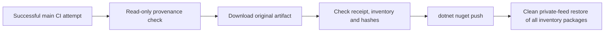

# Private packages

The owner narrowed Phase 5 on 2026-10-06 to clean packaging, MinVer versioning and private NuGet publication, following the reference projects where they fit. The workflow uses the existing [Release package validation](packages.md), official artifact actions and `dotnet nuget push`. Named-cut automation, compatibility policy and content-verified recovery from #28/#29 are closed as not planned and require a new scoped ticket. This scope does not claim all original #24 acceptance criteria.

## Versions and triggers

MinVer is the only version engine. All Kit packages in `scripts/packaging/inventory.json` use the same version, with minimum `0.1`, tag prefix `v` and default prerelease identifiers `preview.0`. The full-history checkout supplies tags to the existing build, tests and `pack --no-build` path. Publication downloads those packages and never rebuilds or overrides their version.

| Event | Version and behaviour |
|---|---|
| PR, tag push, integration branch (`feat/**`) push or manual CI on a non-main branch | Read-only CI validates packages and consumers. No publication from these runs. |
| Main push | CI derives the MinVer Git-height prerelease, then successful CI authorizes private publication. |
| Owner-created `v0.x` preview/rc tag on current main, followed by manual CI on main | CI fetches the tag and validates its exact MinVer version. Successful CI uses the same private publisher. |
| Manual private-publication run on main | Select an original successful main CI run, attempt and SHA. Reuse its preserved packages and manifest. |

Integration branch (`feat/**`) pushes trigger read-only CI; other topic branch pushes do not, so use PR validation or [manual branch CI](ci.md) when hosted proof is needed. Publication triggers only on a completed `main` CI run (`branches: [main]` under `workflow_run`), so neither an integration branch run nor a non-main manual run can authorize it.

For a named version, choose and create an immutable tag such as `v0.2.0-rc.1` on the current main SHA using the normal owner-controlled Git process. Then select **CI**, **Run workflow**, branch **main**, or run:

```bash
gh workflow run ci.yml --ref main
```

Do this before main advances. Inspect the validation artifact's version before consuming it. A tag push alone only validates; publication accepts main CI runs, not tag-head runs. No workflow creates a tag or GitHub Release. Stable versions and public publication require later owner decisions; the publisher accepts only `0.x` preview/rc versions.

## Publication and trust

[`private-publication.yml`](../.github/workflows/private-publication.yml) responds to completed CI on main, outside cancelable CI. Its read-only authorization job fetches the exact original run attempt using `actions/github-script`. It requires the fixed private repository, main default branch, CI workflow path, main source branch, same repository/head repository, selected SHA, a successful completed run and successful AI/package-validation jobs. The original event must be `push` or `workflow_dispatch`. A PR artifact or a failed validation cannot authorize publication.

The authorized job calls [`package-publication.yml`](../.github/workflows/package-publication.yml) with job permissions `contents: read`, `actions: read` and `packages: write`. Checkout uses the trusted main workflow revision with `persist-credentials: false`. Downloaded packages supply no executable code. Only this job receives package-write permission; the push/restore step uses its ephemeral `GITHUB_TOKEN`, with no PAT or new access setting.

`actions/download-artifact` downloads `package-validation-<run_id>-<run_attempt>` from the original run and rejects an artifact digest mismatch. The job binds `validation.json` to the authorized run, attempt, event and SHA; checks the version, source SHA and existing inventory; and checks every original package against `manifest.json`. The original artifact and manifest remain unchanged, with CI's existing 90-day retention. Missing or expired originals fail instead of triggering a replacement build.

The `pouryakit-private-publication` job group has `cancel-in-progress: false`. It covers download, verification, push and restore. GitHub retains one running and one pending member; a newer pending member can replace the older pending member. Re-run an evicted attempt if needed. This is serialization, not a durable queue. See [GitHub concurrency](https://docs.github.com/en/actions/how-tos/write-workflows/choose-when-workflows-run/control-workflow-concurrency).

Publication uses only `https://nuget.pkg.github.com/PouryaNoufallah96/index.json`. The source credentials come from the job token through `NuGetPackageSourceCredentials_GitHub`; the temporary configuration contains no credential. Each original nupkg goes through the standard command:

```bash
dotnet nuget push "$package" --source GitHub --api-key "$GITHUB_TOKEN" \
  --skip-duplicate --no-symbols --configfile "$RUNNER_TEMP/publication.NuGet.Config"
```

`--skip-duplicate` treats an HTTP 409 as a skipped duplicate. It does not compare remote bytes with the manifest and does not prove identical-content recovery. Other push failures fail the job. After push, a temporary project references every inventory package at its exact version and restores with a fresh package/cache directory. Source mapping requires `PouryaKit.*` from GitHub Packages and permits third-party dependencies from nuget.org. This checks private-feed availability and dependency resolution, not remote raw-byte identity or runtime behaviour.



## Retry preserved originals

Re-run the publication workflow, or manually select an original main CI identity:

```bash
gh workflow run private-publication.yml --ref main \
  -f run_id=<original-run> -f run_attempt=<original-attempt> -f source_sha=<original-main-sha>
```

The first hosted attempt left Domain `0.1.0-preview.0.10` visible in the feed. Successful [retry run 37465070135](https://github.com/PouryaNoufallah96/PouryaKit/actions/runs/37465070135) completed that version from original main CI run `37456433718`, attempt `1`, artifact `11408539884`, source `2de265641b8cd94a5ddc17980cdcad530f0a8f60`: Domain returned HTTP 409 and was skipped, the remaining twelve packages were pushed, and all thirteen restored with fresh caches. Preserve the original manifest/packages and retry record; never delete, replace or repack that version. The duplicate skip and restore provide no remote raw-byte identity proof.

## Hosted completion

The active Phase 5 scope completed on 2026-10-06 at main commit `b234f4f6c3ac113cf3fd8d874b88d20571480cef`. [CI run 37465576160](https://github.com/PouryaNoufallah96/PouryaKit/actions/runs/37465576160) passed 386 runtime tests with zero failures or skips, validated thirteen packages and built fifteen clean consumers at MinVer `0.1.0-preview.0.13`. [Publication run 37466084084](https://github.com/PouryaNoufallah96/PouryaKit/actions/runs/37466084084) published those original packages and completed the clean thirteen-package private-feed restore. This proves publication and feed availability for that version, with the byte-identity and fork-execution limits above and in [CI guidance](ci.md#hosted-proof-boundary).

## Consume one complete version

Choose a version whose publication job completed its restore of all inventory packages, and use it for every Kit package reference. Developer restore uses an existing authorized classic token with `read:packages`; a consuming workflow can use its repository token where it already has package access. This workflow adds no developer credential or access grant. See [GitHub's NuGet authentication guide](https://docs.github.com/en/packages/working-with-a-github-packages-registry/working-with-the-nuget-registry#authenticating-to-github-packages).

Add the source and mapping to the consuming project's `NuGet.Config`, keeping credentials outside it:

```xml
<configuration>
  <packageSources>
    <add key="GitHub" value="https://nuget.pkg.github.com/PouryaNoufallah96/index.json" />
    <add key="nuget.org" value="https://api.nuget.org/v3/index.json" />
  </packageSources>
  <packageSourceMapping>
    <packageSource key="GitHub"><package pattern="PouryaKit.*" /></packageSource>
    <packageSource key="nuget.org"><package pattern="*" /></packageSource>
  </packageSourceMapping>
</configuration>
```

Supply `NuGetPackageSourceCredentials_GitHub` through the shell or secret manager as `Username=<authorized-login>;Password=<read-token>;ValidAuthenticationTypes=Basic`. The source name and environment-variable suffix must agree. Consume packages without a Kit checkout or project references, as [package guidance](packages.md) describes.

## Reference sources

The standard CLI loop follows [`meysamhadeli/woo@149a3cf168496c3bec85945f83ad222e43720e4d .github/workflows/publish.yml`](https://github.com/meysamhadeli/woo/blob/149a3cf168496c3bec85945f83ad222e43720e4d/.github/workflows/publish.yml#L89). The Kit keeps its existing exact inventory, validated artifacts and MinVer instead of Woo's separate version input and public-feed secret. Full history and build/test gating also appear in [`mehdihadeli/CloudNativeKit@e81d65e6376008cb001fdbd886086dc6e84790c6 .github/workflows/build-and-publish.yml`](https://github.com/mehdihadeli/CloudNativeKit/blob/e81d65e6376008cb001fdbd886086dc6e84790c6/.github/workflows/build-and-publish.yml#L26). These are source comparisons, not proof of successful upstream publication runs.
