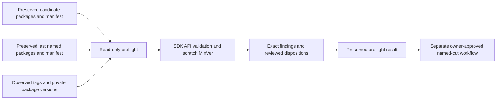

# Named-release preflight

Issue [#28](https://github.com/PouryaNoufallah96/PouryaKit/issues/28) checks a named candidate before production tag, package or release writes. It consumes the preserved output of the [shared package proof](packages.md). It never builds replacement packages during comparison.

## Run

Prepare candidate packages in an external scratch checkout at the selected full SHA, under scratch tag `v<version>`, using the shared package proof. Preserve its complete output. An internal snapshot cannot be relabeled as a named candidate. The candidate manifest, every nuspec version, scratch tag and real MinVer `Version`, `PackageVersion` and `MinVerVersion` must agree exactly. A requested build-metadata suffix fails because MinVer excludes that suffix from package/build versions.

```bash
python3 scripts/releases/preflight/preflight.py \
  --candidate /external/candidate-proof \
  --version 0.2.0-rc.1 \
  --baseline /external/last-named-proof \
  --reference-directory /external/preserved-dependency-references \
  --output /external/fresh-preflight
```

The output directory must be fresh and outside the checkout. Omit `--baseline` only for the first named release. The tool uses `gh api` GET requests with pagination to observe all version tags in `PouryaNoufallah96/PouryaKit` and the owner's NuGet packages and versions. Use `--github-repository` and `--owner-kind orgs` for another repository owner. Its existing authentication needs repository visibility and `read:packages`; authentication or pagination failures fail the check. The tool neither prints credentials nor accepts a secret argument. An empty package list is accepted only after a successful package enumeration, rather than treating failed individual version lookups as absence.

Supply reference directories from the preserved dependency closure when packaged APIs use third-party assemblies. The tool resolves the pinned SDK's .NET and ASP.NET Core framework references and adds candidate and baseline Kit assemblies separately. Before comparison, the SDK's official `AssemblySymbolLoader` loads both packages with reference resolution enabled. Its errors, warnings, high-importance messages, missing symbols and exceptions fail the check, including first releases. `lib`, `ref` and managed `runtimes` asset groups are checked independently. Only the currently shipped `net10.0` target is configured; unsupported groups fail.

The loader searches DLL parent directories and resolves by assembly filename. This establishes reference availability, not dependency version identity or semantic compatibility. Physically isolated missing-reference fixtures prevent an installed reference-pack directory from supplying an omitted sibling DLL.

For local policy proof, pass `--history history.json`. Every file passed through this option is a fixture, even if its contents claim an observed source. Such results always have `publication_eligible: false` and cannot establish the hosted first-release baseline. The fixture shape is:

```json
{
  "named": [{"version": "0.1.0-preview.1", "commit": "full-40-character-sha"}],
  "published": [{"id": "PouryaKit.Domain", "version": "0.1.1-preview.0.2"}]
}
```

## Policy and findings

The request must be strict SemVer and greater than every named and published version. Python validates the SemVer grammar and compares precedence with case-sensitive ASCII ordering and arbitrary-size numeric identifiers, ignoring build metadata. Numbers compare by digit count then lexical order without integer conversion. The check derives no version; MinVer still exclusively generates package/build versions. NuGet's comparer is unsuitable because it folds case and treats large numeric identifiers as strings. Already published NuGet identities also reject collisions differing only by case or build metadata. Initially only major `0` with a first prerelease identifier `preview` or `rc` is allowed. Valid suffixes and bare channels are accepted. Stable versions, other channels and `1.x` are refused.

The highest named version identifies the required baseline SHA and version. Every baseline package must exist with the expected inventory, nuspec identity, repository commit and manifest checksum. Existing named history with missing baseline artifacts fails. Observed empty named history records that no baseline exists, runs intrinsic SDK package validation, and claims no baseline comparison.

The SDK `ValidatePackageTask` compares frozen candidate packages against preserved baseline packages in the forward direction. A reverse comparison identifies candidate API additions through missing-type/member diagnostics `CP0001` and `CP0002`. Other reverse diagnostics, such as changed parameter names, are breaking findings. Both comparisons use public parameter-name and attribute checks. The raw unsuppressed result and generated suppression XML are preserved separately. Generating XML discovers findings; it does not approve them. Tool failures, unresolved references and intrinsic package failures cannot receive a compatibility disposition.

An unchanged public API can proceed as a compatible patch. Each additive finding requires an explicit `compatible-addition` disposition and a minor increment. Each breaking finding requires `reviewed-break`, a minor increment, migration notes, a named reviewer and a rationale. From `1.0`, the recorded policy requires a major increment for breaks; stable activation remains an owner decision and is currently refused. SDK checks establish API/framework evidence only. They do not prove semantic compatibility of implementations.

The first run with findings exits `1` and writes the findings to `result.json`. Review those diagnostics. Construct a review JSON by copying its exact `candidate` and `baseline` objects, including manifest and package hashes, and adding:

```json
{
  "candidate": {},
  "baseline": {},
  "migration_notes": "Describe the consumer migration for reviewed breaks.",
  "dispositions": [
    {
      "key": "exact-finding-key-from-result",
      "decision": "reviewed-break",
      "reviewer": "review identity",
      "rationale": "Why this API change is accepted."
    }
  ]
}
```

Rerun with `--review review.json` into another fresh output directory. Every actual finding requires exactly one matching disposition. Missing, duplicate, extra, stale or insufficient dispositions fail. The key binds the package, comparison direction, exact SDK diagnostic and complete candidate/baseline identities. Do not edit or reuse SDK suppressions as approval.

## Handoff to the named-cut workflow

`result.json` schema `1` records `status`, `publication_eligible`, the SDK version, candidate and baseline identities, history and its hash, scratch MinVer evidence, SDK comparisons, findings/dispositions, the submitted review and `production_unchanged`. Identity objects contain `commit`, `version`, `manifest_sha256` and the #25 package rows `id`, `file`, `sha256`. Exit `0` means all local preflight checks passed. Exit `1` means refusal and includes `error`. Frozen manifests/packages and SDK logs live beside the result.

The caller must require both `status: passed` and `publication_eligible: true`, then independently establish owner approval and the exact green-main SHA, revalidate these identities immediately before a write and preserve this result with the publication record. The observation is a point-in-time history snapshot, so publication serialization and a final conflict check belong to #29. This preflight alone does not authorize publication or prove hosted execution/feed recovery.

The tool clones full local Git history to an external directory, adds the candidate tag there only, restores the selected commit's Domain project and runs its actual MinVer target without version overrides. MinVer alone determines versions. Assembly normalization remains MinVer's `major.0.0.0` assembly version and `major.minor.patch.0` file version. Production refs, HEAD and status are captured before/after and must match. Git trace telemetry is disabled per subprocess because ambient trace consumers can hydrate notes refs during clone; global configuration is untouched.



## Evidence and sources

`python3 tests/releases/preflight/test_preflight.py` builds real baseline, compatible patch, additive, removed-API and renamed-parameter nupkgs in external temporary repositories. It proves SDK `CP0002` rejection, reviewed additions/breaks, insufficient increments, missing notes/dispositions, stale hashes, missing/wrong baselines and artifacts, case-sensitive preview/rc order, numeric fields beyond Int32 and 4,300 digits, metadata collisions, strict syntax, competing tags and real MinVer equality. It also checks physically missing direct/transitive/baseline/first-release references and every supported managed asset group. `python3 tests/releases/preflight/red_once.py` runs these guarantee tests against external copies with individual behaviours disabled and requires failure. Source refs/status snapshots prove local isolation.

The preflight also passed intrinsic validation over all thirteen genuine #25 packages at source `926653b4d46b4fe59853b604ff0ebd5ab2ae2d71`, version `0.1.0-preview.0.6`, using 100 references from their preserved consumer closures. That integration used fixture history and was publication-ineligible. These are local package/tool tests, not observed GitHub Actions or private-feed publication evidence. The Kit's unchanged PostgreSQL runtime guarantees are outside this tooling test.

Primary implementation sources:

- `dotnet/sdk@32593ca81f8aae7b0d41c1a7198529c3365106b8`, [src/Tasks/Microsoft.NET.Build.Tasks/targets/Microsoft.NET.ApiCompat.ValidatePackage.targets](https://github.com/dotnet/sdk/blob/32593ca81f8aae7b0d41c1a7198529c3365106b8/src/Tasks/Microsoft.NET.Build.Tasks/targets/Microsoft.NET.ApiCompat.ValidatePackage.targets). The wrapper invokes the installed pinned SDK task directly against existing artifacts and has no incremental Pack semaphore.
- The same SDK revision's [src/Compatibility/Microsoft.DotNet.ApiSymbolExtensions/AssemblySymbolLoader.cs](https://github.com/dotnet/sdk/blob/32593ca81f8aae7b0d41c1a7198529c3365106b8/src/Compatibility/Microsoft.DotNet.ApiSymbolExtensions/AssemblySymbolLoader.cs), [Logging/ILog.cs](https://github.com/dotnet/sdk/blob/32593ca81f8aae7b0d41c1a7198529c3365106b8/src/Compatibility/Microsoft.DotNet.ApiSymbolExtensions/Logging/ILog.cs) and [Logging/MessageImportance.cs](https://github.com/dotnet/sdk/blob/32593ca81f8aae7b0d41c1a7198529c3365106b8/src/Compatibility/Microsoft.DotNet.ApiSymbolExtensions/Logging/MessageImportance.cs) define the typed reference guard.
- [SemVer 2.0 precedence](https://semver.org/spec/v2.0.0.html#spec-item-11) defines the comparator's numeric, ASCII and metadata rules.
- Microsoft's [baseline package validation](https://learn.microsoft.com/en-us/dotnet/fundamentals/apicompat/package-validation/baseline-version-validator) and [package validation properties](https://learn.microsoft.com/en-us/dotnet/core/project-sdk/msbuild-props#package-validation-properties) describe baseline diagnostics, references and suppression inputs.
- `adamralph/minver@9f485aabb9936efd8fb8b633ae09ae4d0659c94f`, [README.md](https://github.com/adamralph/minver/blob/9f485aabb9936efd8fb8b633ae09ae4d0659c94f/README.md), defines exact-tag and build-metadata behavior.
- GitHub's [repository tags](https://docs.github.com/en/rest/repos/repos#list-repository-tags) and [package versions](https://docs.github.com/en/rest/packages/packages#list-package-versions-for-a-package-owned-by-a-user) are the read-only history interfaces.

Value: compatibility and version refusals happen before irreversible release writes. Cost: one isolated SDK wrapper, preserved comparison inputs and per-finding review. Impact: release tooling and its audit record; no Kit runtime API changes.
